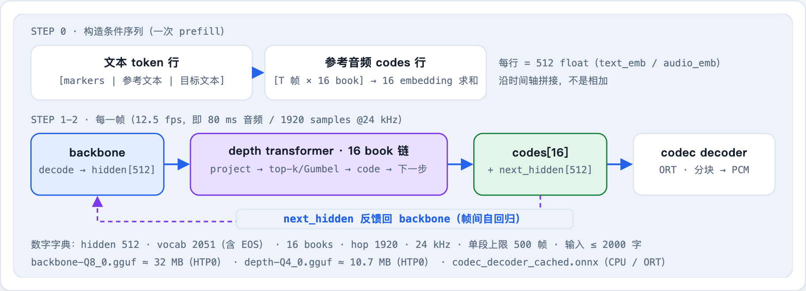

# M5-TTS 端侧推理实战（一）｜在无 HMX 的 Snapdragon 上把模型拆给 HTP 和 CPU

开源仓库：[wangyifan2018/llama.cpp](https://github.com/wangyifan2018/llama.cpp) · [M5-TTS 代码与运行说明](https://github.com/wangyifan2018/llama.cpp/tree/master/examples/m5-tts)

这次移植的目标是让一台 Android 设备本地生成中文座舱播报。它要能说「车窗已关闭」这种短指令，也要能边生成边播放较长的导航和闲聊。设备的 Hexagon HTP 可以跑 HVX，但本次部署没有可用的 HMX 路径。遇到这种设备时，最先要回答的是**一帧音频由谁计算，下一步在等什么**。

本文用 M5-TTS-50M 的 ONNX 权重作参考，介绍怎样把 backbone 和 depth core 接入 llama.cpp，并保留 CPU 上的音频 heads 与 codec。性能数字只描述文中的设备、模型和测试形状。

## 一帧音频要经过两条自回归链

*图 1　Backbone 逐帧生成 hidden，depth 生成码本，codec 分块解码。来源：学习中心图 1-1。*

每帧包含 16 个码本索引，对应 24 kHz 下的 1920 个样本，也就是 80 ms。帧内，首码本和后续 15 个码本的生成存在条件依赖。帧间，当前帧结果还会参与构造下一帧的输入。codec 可以在生成端继续工作的同时处理已经形成的码本块，这给了流水线重叠的空间。

这种结构解释了为什么「HTP 已经跑通」只能回答一部分问题。假如同一个 depth 图每帧提交 15 次，提交、等待和回读都要重复支付。即使 core 算得很快，CPU 仍需要组织下一步的输入。

## GGUF、ONNX 与 llama.cpp 的分工

| 部分 | 模型与执行方式 | 要守住的接口 |
| --- | --- | --- |
| 文本与参考前缀 | 主机侧 tokenizer、embedding、音色资产 | token 顺序、参考转写、位置索引 |
| Backbone | 从 ONNX 转出 GGUF，复用 llama.cpp 图，在 HTP 执行主要计算 | prefill 输入、逐帧 hidden、缓存位置 |
| Depth core | 从 depth ONNX 提取可复用部分并转换成 GGUF，在 HTP 执行主要计算 | 第几步、上一步码本、KV 和输出 hidden |
| 音频 heads 和采样 | CPU 上的投影与采样 | 码本索引、终止条件、固定 seed 的行为 |
| Codec decoder | ONNX Runtime CPU，分块维护状态 | 缓存、分块边界、PCM 拼接 |

GGUF 是模型和权重的存储格式。GGML 图描述算子和张量之间的依赖，后端负责执行它能支持的部分。当前的 codec 仍是一段独立的 ONNX 图；要迁移其中一个子图，需要先建立与原图的张量和状态对应关系，再接入 GGML 或用其他后端执行。

## 按边界验收，比从 WAV 倒查更容易

**第一步，保留可运行的 ONNX CPU 参考。** 固定模型文件、文本、音色、seed，先记录 tokenizer 和前缀输出，再确定计时从哪里开始。加载模型、首个请求和常驻热运行可以分别记录。

**第二步，只替换 backbone。** 同一组输入分别给 ONNX 和 llama.cpp，对比 prefill 和连续 decode 的 hidden。转换和对照脚本分别是 `convert_backbone.py` 与 `compare_backbone.py`。如果第一个位置就偏离，先看权重映射、张量轴和位置索引；随后才看更长的生成序列。

**第三步，回放真实 depth 输入。** 让 CPU 参考导出逐步 hidden、KV 和码本输出，再逐步比较 HTP 路径。项目里的 `capture_depth_reference.py` 与 `check_depth_codes.py` 服务于这一层。深层误差开始出现的步数，比只比较两份最终 WAV 更容易定位问题。

**第四步，常驻执行并跑全链路。** 常驻 stage 避免每句重载模型。连续发两条不同文本，检查位置、KV 和 codec 状态是否按请求重置，再测首包、墙钟和帧数。部署时可用 `GGML_HEXAGON_NHMX=0` 复现无 HMX 的执行路径。

## 一个适合用来练习划分边界的反例

codec 尾部曾抽取真实流式四帧输入，测试一个 96 通道、7 taps、dilation 9 的卷积。生产 ORT 的该算子中位数约 **11.03 ms**。将它改写成 HTP 支持的 im2col + MatMul 后，包含上传、等待和读回的隔离探针约 **45.96 ms**；另一种 HVX 分块实现约 **79.9 ms**。

这组数字的计时边界不同，适合用来判断这个迁移方案现阶段是否值得继续。它也给出了下一次移植的检查项：使用真实 chunk 形状，比较原算子和新子图，单独记录边界开销，再验证端到端 PCM。当前部署将该 codec 子图留在 CPU，HTP 资源优先用于 backbone 与 depth。

下一篇会从一次完整请求出发，解释为什么 RTF 会在请求更慢时下降，以及怎样估算一次算子优化最终能省多少时间。

- [M5-TTS 模型与 ONNX 参考实现](https://github.com/ASLP-lab/M5-TTS)
- [移植记录与实验命令](https://github.com/wangyifan2018/llama.cpp/blob/master/docs/backend/snapdragon/m5-tts-port-notes.md)
