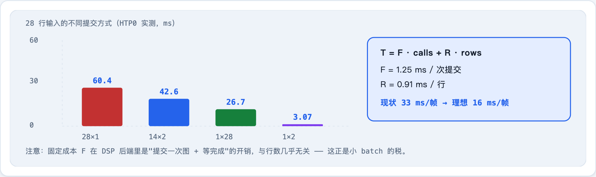

# M5-TTS 端侧推理实战（二）｜从 RTF 到 FastRPC：怎样剖析一次语音请求

开源仓库：[wangyifan2018/llama.cpp](https://github.com/wangyifan2018/llama.cpp) · [M5-TTS 代码与运行说明](https://github.com/wangyifan2018/llama.cpp/tree/master/examples/m5-tts)

有一次 Flash Attention 实验，报告中的 RTF 从 0.700 降到 0.666。原始数据是墙钟 **3.724 → 3.914 s**，音频时长 **5.32 → 5.88 s**。请求多等了 190 ms，RTF 下降是因为生成的音频更长。对于希望尽快听到下一步导航的用户，墙钟和首包是直接的体验指标，帧数变化还可能意味着语速或停顿发生变化。

## 从用户请求记录四个数字

| 指标 | 定义 | 用途 |
| --- | --- | --- |
| 墙钟 | 约定的请求起点到生成完成 | 比较实际等待；客户端测量时还应包含排队和传输 |
| 首 PCM | 请求开始到首个非空 PCM 块 | 估计什么时候能开始播放 |
| 帧数与音频时长 | 实际生成的码本帧和 WAV 时长 | 发现输出长度或终止行为变化 |
| RTF | 生成墙钟 ÷ 输出音频时长 | 衡量连续生成能否追上播放 |

HTTP 响应头可以早于音频发出。测流式首包时应以第一个非空 PCM 块为准，产品侧还可以另记首个实际可以播放的时刻。短车控句更容易被固定开销支配，同一版本即使长句实时，也可能在短句上出现 RTF 大于 1。

比较配置时，我固定文本、音色、seed、codec 分块、线程数和服务入口。每组先热身，随后交替跑 A/B，避免两组分别占据设备不同的运行状态。报告保留次数、中位数和范围，再附帧数与转写。CLI 和 server 如果配置不同，应分别列出。

## 从分项计时还原关键路径

在一次 69 帧 CLI 对照里，新默认的记录如下。

| 项目 | 耗时 |
| --- | ---: |
| Backbone | 0.726 s |
| Depth | 2.853 s |
| Codec | 2.820 s |
| 墙钟 | 3.775 s |

三段相加约 6.40 s，超过墙钟，因为 codec 在后台消费已经生成的码本。一个方便的近似是：

```text
wall ≈ backbone + max(depth, codec) + 未重叠开销
     ≈ 0.726    + max(2.853, 2.820) + 0.197
     = 3.775 s
```

这个模型把流水线中未表示的等待、启动和收尾归到残差。它适合指导实验，换分块、文本长度和并发形态以后要重测。按这组数，单独把 codec 算快 20%，它仍位于较短的一侧，墙钟预测几乎不变；若只加快 depth，则两侧原本只差约 33 ms，很快就轮到 codec 主导。

## 区分每次提交成本与每行计算成本

为了定位 depth 的成本，我用 `depth_batch_bench.cpp` 对比相同行数的不同提交方式。

| 提交方式 | HTP 微基准耗时 |
| --- | ---: |
| 1 次 × 28 行 | 26.7 ms |
| 14 次 × 2 行 | 42.6 ms |
| 28 次 × 1 行 | 60.4 ms |
| 1 次 × 2 行 | 3.07 ms |



*图 1　固定总行数时，提交越碎，累计开销越高。来源：学习中心图 5-1。*

在该组形状上，拟合约为 **1.25 ms/次提交 + 0.91 ms/行**。它把 FastRPC 路径上的固定开销和随输入规模增长的计算分开了。合并提交的理论空间很大，但真实 depth 每一步需要上一步的采样。把这部分条件输入清零后，实验中约 99.6% 的码本索引发生变化。这个消融结果足以优先把时间花在保留计算语义的单步优化上。

一个容易混淆的实验是 `--depth-chain`：它把主进程与 stage 之间的 pipe 往返合并为每帧一次，HTP 内仍要按依赖执行多个步骤，所以实测大体持平。剖析时应分别计 host IPC、后端提交和设备计算。

## CPU 占用用两个指标报告

同一条请求在单独的 CPU 计量实验中，codec 用 3 线程时约 **3.61 s 墙钟、10.62 CPU-s、平均 2.94 核**；改 1 线程后约 **4.81 s、12.05 CPU-s、平均 2.50 核**。这里的 CPU-s 是服务及两个 stage 进程族在请求窗口内的累计 CPU 时间。限制线程可以减少平均占用，但这次测量里每个任务消耗的累计 CPU 时间反而增加了。

如果目标是座舱共存，建议把请求排队时间、平均核数和 CPU-s 放到同一张表。单路 RTF 无法回答播放音乐、导航或其他进程同时运行时，高分位延迟会怎样变化。

下一篇将用 KV32 和 codec 分块说明，怎样把这套剖析办法变成通过回归验证的产品改动。

[完整对照与原始口径（实验 §3.1、§16、§17、§29）](https://github.com/wangyifan2018/llama.cpp/blob/master/docs/backend/snapdragon/m5-tts-optimization-log.md)
