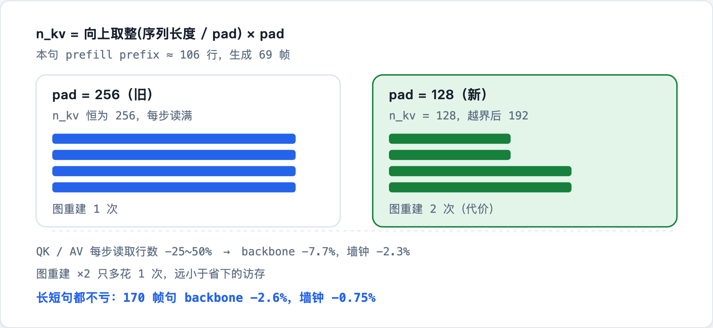
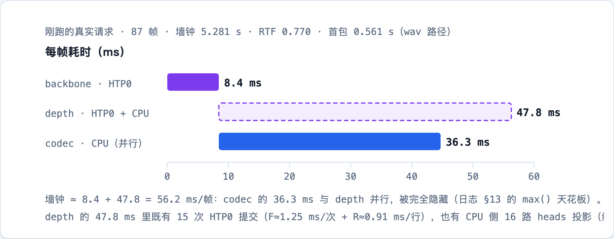

# M5-TTS 端侧推理实战（三）｜保住听感，再把服务端样句做到 RTF 0.677

开源仓库：[wangyifan2018/llama.cpp](https://github.com/wangyifan2018/llama.cpp) · [M5-TTS 代码与运行说明](https://github.com/wangyifan2018/llama.cpp/tree/master/examples/m5-tts)

这个项目有两个容易混淆的 INT8。**音频 heads 的 INT8**用在码本预测的投影上，主要节省 CPU 上的权重读取。**codec 的 INT8**用在波形解码上，对背景底噪更敏感。KV 的精度又是另一条轴。实验里我们分别比较这些改动，听到噪音或韵律变化时才能定位来源。

本文记录最终采用的 KV 读取优化和服务分块，以及哪些尝试因为质量或墙钟收益被搁置。

## KV32 缩短的是读取范围

本次部署的 depth 链短。旧路径将 attention 可见的 KV 读取范围按 256 对齐，造成大量无效位置仍进入计算。将 depth 的读取对齐改为 32 后，FP32 KV 和普通注意力继续使用。HTP 在满足形状条件时直接散写 V，减少原路径上不必要的中间搬运。

*图 1　KV 对齐改变了 attention 的读取范围。来源：学习中心图 11-2。*

固定 Serena、seed 1234、同一条 69 帧句，用 A/B/C 正反交替共运行 12 次。下表取中位数。

| 配置 | 墙钟 | Depth | RTF |
| --- | ---: | ---: | ---: |
| KV32 + 直接写 V | **3.775 s** | **2.853 s** | **0.710** |
| KV 对齐恢复 256 | 4.163 s | 3.261 s | 0.783 |
| KV32，关闭直接写 V | 3.894 s | 2.970 s | 0.732 |

这组对照的 codes 和 WAV 哈希完全一致。比较第一行和第二行，墙钟下降约 9.3%；第一行和第三行的差距说明直接写 V 在该配置下还有约 3.1% 的墙钟收益。backbone 的上下文更长，跨过对齐边界可能改变图形状，因此单独调参。该实验保持 backbone 原来的对齐，后续才独立验证 128 对齐。

## 为什么没有采用 Flash Attention

我们比较了普通注意力、FP16 KV 及不同 Flash 候选。即使把 Flash 候选的 KV 保留为 FP32，固定输入和 seed 的对照仍出现了码本和 WAV 差异。有候选的 RTF 下降，但墙钟上升，输出也多生成了若干帧。试听还发现韵律或个别字发声有变化。

对于要保持计算语义的工程优化，先对比固定 seed 的 codes 与 WAV。若实验允许改变数值，则追加转写、音频时长、背景底噪和听感评估。FP32 codec 的参考录音帮助确认 INT8 codec 的沙沙声。转写一致的样本也可能有底噪或语速问题。

## 产品分块要看 codec 什么时候完成

KV32 改完后，CLI 的耗时无法直接代表产品，因为 WAV 接口仍在用旧的 `first=4, chunk=16`。旧配置可以少调用 ONNX，但末尾的大块 codec 工作更容易延伸到 depth 结束以后。下面是同一个 server 的分块扫描。

| 首块 / 后续块 | 墙钟中位数 | 首 PCM | Codec 累计耗时 |
| --- | ---: | ---: | ---: |
| **2 / 4** | **3.596 s** | **0.270 s** | 2.47 s |
| 4 / 8 | 3.729 s | 0.405 s | 2.33 s |
| 2 / 16 | 3.930 s | 0.270 s | 2.25 s |
| 4 / 16（旧默认） | 4.000 s | 0.411 s | 2.25 s |

最小的单项 codec 时间出现在 16 帧分块，但墙钟最短的是 4 帧分块。首块用 2 帧，后续每 4 帧提交一次，更容易把 codec 工作和 depth 重叠。一次更激进的 1 帧试验反而让首包变慢，需额外支付一次 ORT 调用和状态准备。

*图 2　Depth 与 codec 重叠执行，较晚结束的一侧决定这一段墙钟。来源：学习中心图 11-5。*

最终产品路径使用 `2/4`。这条 69 帧样句在 WAV 模式下约 **3.60 s 墙钟、RTF 0.677、首包 0.27 s**。新旧分块的转写一致，波形差异集中在尾段一个 overlap 窗口。这里的逐字节一致性适用于相同分块的 CLI 与 server 对照，旧分块和新分块之间需要另外检查尾音。

## 把并发结果放回座舱场景

同一请求在独立并发实验中，单路约 3.61 s，吞吐约 1.47 倍实时。双服务真并行约 6.76 s/请求，总吞吐只到约 1.57 倍实时。CPU 时间从约 10.6 增至约 20.5 CPU-s/请求。这台设备上的第二条请求会争用 HTP 和 CPU，单路达实时不能直接推导出双路也能达实时。

因此上线对照按短车控、导航、长闲聊分别记录首包、墙钟、转写和试听，额外测高负载下的排队。若继续研究两阶段 depth 或更窄的 codec，先重建当前基线，分开记录训练方案的估算与实测。

[原始测试与参数（实验 §16、§17、§25、§29）](https://github.com/wangyifan2018/llama.cpp/blob/master/docs/backend/snapdragon/m5-tts-optimization-log.md)
