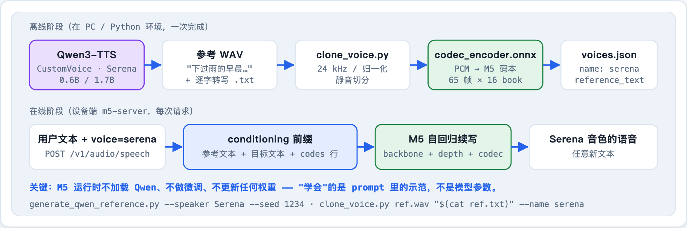

# M5-TTS 端侧推理实战（四）｜把 Qwen3-TTS 的 Serena 做成座舱播报音色

开源仓库：[wangyifan2018/llama.cpp](https://github.com/wangyifan2018/llama.cpp) · [M5-TTS 代码与运行说明](https://github.com/wangyifan2018/llama.cpp/tree/master/examples/m5-tts)

座舱语音要覆盖三个听感目标。车控要求短句听清结果，导航要求数字和方位有清晰的节奏，闲聊允许更自然的句间起伏。这个项目选取 Qwen3-TTS CustomVoice 的 Serena 作参考，用 M5-TTS 实际播报，部署只保留一个名为 `serena` 的音色。

## 从参考 WAV 转成 M5 的音色条件



*图 1　离线生成参考并存为 M5 音色资产，设备端按音色 ID 合成。来源：学习中心图 13-1。*

两个模型通过 PCM 音频交换参考。Qwen3-TTS 自己的码本和 M5 的码本属于各自的 tokenizer。M5 用部署模型对应的 encoder 重新编码 WAV，再用自己的音色条件做生成。换源模型时，只需要让新模型生成参考 WAV 并保存精确转写，后面的 M5 编码与注册可以复用。

## 两条命令生成可部署资产

在仓库的 `examples/m5-tts` 目录执行。参考生成需要安装 `qwen-tts` 的独立 Python 环境；M5 编码需要 NumPy、ONNX Runtime 和部署模型匹配的 encoder。用实际目录设置 `M5_ENCODER_DIR`。

先生成 Serena 参考。脚本会写出 WAV 和同名 TXT。

```bash
python generate_qwen_reference.py serena-reference.wav --speaker Serena
```

先听一遍 WAV，把 TXT 改成录音实际说出的内容。数字、停顿前后的词、重复或漏字都值得核对。然后切到 M5 编码环境运行：

```bash
python clone_voice.py serena-reference.wav "$(cat serena-reference.txt)" \
  --model "$M5_ENCODER_DIR" \
  --voices serena-voices.json \
  --name serena
```

CLI 通过 `--voices serena-voices.json --voice serena` 选择该资产。若要把音色合并进运行中的 Web 服务，可以用页面的音色导入功能，或者向 `POST /v1/voices/clone` 提交音色条目及同文件的 `encoder_sha256`。更换 M5 encoder 或模型版本时，校验身份，并在需要时从参考 WAV 重新编码。

## 用三类未见文本选择参考

第一轮听测用与参考录音不同的句子。比较两份参考时保持目标文本、codec 精度、推理参数和 seed 一致。每次只换一个参考，避免把 codec 的底噪或 KV 的韵律变化误判成音色变化。

| 场景 | 测试句 | 重点复听 |
| --- | --- | --- |
| 车控 | 车窗已关闭。 | 句首是否完整，确认结果是否清楚，尾音有无破裂 |
| 导航 | 前方三百米右转，随后靠左行驶。 | 数字、左右方位和两条指令间的停顿 |
| 闲聊 | 辛苦啦，路上不用着急。等到了，我们再慢慢聊。 | 两句之间的起伏、停顿及静音底噪 |

仓库保留了这三条示例。它们使用当时的 INT8 codec 配置，音色之间的听感比较可以再用 FP32 codec 复听，以隔离 INT8 解码底噪的影响。转写可以辅助发现错字、漏字或重复，仍要听数字重音、句尾以及尾部静音。

## 情感可以在参考生成阶段做实验

要生成一条偏温和的参考，可以给支持指令的源模型添加 `--instruct`，例如：

```bash
python generate_qwen_reference.py serena-warm-reference.wav \
  --model Qwen/Qwen3-TTS-12Hz-1.7B-CustomVoice \
  --speaker Serena \
  --instruct '语气轻柔温暖，语速略慢，句尾自然放轻。'
```

这条指令作用在参考生成阶段。M5 读取的是重新编码后的参考条件，能迁移多少语气需要盲听。若希望同一个 `serena` 在运行时按每句 instruction 改变情感，先固定文本、音色、seed 和解码配置，只改变 M5 的指令输入。用多个听者判断方向是否一致，同时检查清晰度和重复字。这个实验回答的是 M5 是否接受该控制，参考迁移本身只能展示不同参考资产带来的差异。

- [Serena 示例音频和音色资产](https://github.com/wangyifan2018/llama.cpp/tree/master/examples/m5-tts/voices/serena)
- [Qwen3-TTS CustomVoice 用法](https://github.com/QwenLM/Qwen3-TTS)
