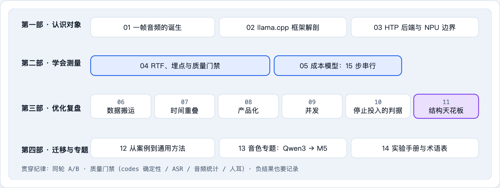
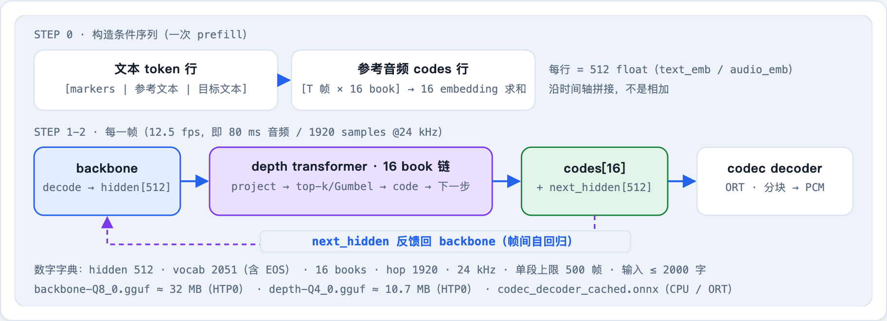

# M5-TTS 端侧推理实战（01）｜认识 M5-TTS：一帧音频是怎么来的

开源仓库：[wangyifan2018/llama.cpp](https://github.com/wangyifan2018/llama.cpp) · [M5-TTS 代码与运行说明](https://github.com/wangyifan2018/llama.cpp/tree/master/examples/m5-tts) · [模型权重与真机复现](https://github.com/wangyifan2018/llama.cpp/releases/tag/m5-repro-v1)

从文本和参考音色开始，沿着 backbone、depth 和 codec 走完整条生成链。

## 第 0 章 · 导读：这门课想让你带走什么

不是"某模型怎么调快"的流水账，而是一套可迁移的推理系统思维——全书按认识对象、学会测量、优化复盘、迁移专题四部展开。

**学完你应该能回答**

- 一个自回归音频模型，为什么它的瓶颈和文本 LLM 完全不同？
- 看到 "RTF 0.9" 这个数字，你会追问哪三个问题？
- "把 15 次调用合成 1 次" 听起来必然更快，为什么连训练一个草稿模型也救不了（第 5、10 章）？
- 量化后 codes 翻转 90%，为什么还算"正确"？什么情况下又必须否决一个量化？
- 两条并行分支几乎打平时，为什么任何单边优化都变成 0（第 11 章）？联合优化需要满足什么条件？
- Serena 的音色是怎样从 Qwen3-TTS 迁移到 M5 的？有没有训练发生？

### 四部结构，一条主线

主线只有一句话：**先看懂数字，再动手；先算清收益，再投入。**四部课程都为它服务—— 第一部让你看得懂流水线与框架，第二部让你看得懂测量，第三部用十几个真实的优化与判死案例把 这句话练成 reflex，第四部把它抽象成可迁移的方法。

*图 0-1　课程结构。第三部第 11 章用成本模型估算 depth 与 codec 联合重训的收益。*

### 三条读法

全书 15 章不必从头读到尾。按你的目的选一条：

**只要结论（约 40 分钟）**

读第 0、5、11 章。你会得到这个系统的完整成本结构、`max()` 天花板的来历，以及"现在还能不能更快"的答案。

**要自己上手（约 3 小时）**

按顺序读。第 1–3 章建立对象，第 4 章学会测量，第 6–9 章跟着六个战场练手，第 14 章是可以直接抄的命令与判据。

**要方法论（约 2 小时）**

读第 4、5、10、11、12 章。这条线讲的全是"怎么判断值不值得做""怎么把一条路判死"，与具体模型无关。

口径约定 本文所有 RTF = 端到端生成耗时 ÷ 生成音频时长（越小越好）。不同章节的数据来自不同长度的测试句与不同设备热状态， **跨章节的绝对数字不可直接比较**；每个结论都标注了它的对照实验。测试约定：同轮交替 A/B、固定种子/文本/音色、 质量门禁 = codes 确定性 + ASR 转写 + 音频统计族（RMS / 过零率 / 峰值）+ 必要时人耳试听。\
引用格式：正文里的"第 N 章"指本书章节，"日志 §N"指优化台账 `docs/backend/snapdragon/m5-tts-optimization-log.md` 的小节——需要看原始实验记录时按它去查。

### 资料来源

- 项目主台账：[`docs/backend/snapdragon/m5-tts-optimization-log.md`](https://github.com/wangyifan2018/llama.cpp/blob/master/docs/backend/snapdragon/m5-tts-optimization-log.md)（日志 §1–§30；时间线细节见 [`m5-tts-port-notes.md`](https://github.com/wangyifan2018/llama.cpp/blob/master/docs/backend/snapdragon/m5-tts-port-notes.md)）
- 代码：[`examples/m5-tts/`](https://github.com/wangyifan2018/llama.cpp/tree/master/examples/m5-tts)（[`m5_engine.cpp`](https://github.com/wangyifan2018/llama.cpp/blob/master/examples/m5-tts/m5_engine.cpp), [`m5_depth_heads.h`](https://github.com/wangyifan2018/llama.cpp/blob/master/examples/m5-tts/m5_depth_heads.h), [`backbone.cpp`](https://github.com/wangyifan2018/llama.cpp/blob/master/examples/m5-tts/backbone.cpp), [`m5_server.cpp`](https://github.com/wangyifan2018/llama.cpp/blob/master/examples/m5-tts/m5_server.cpp)）
- Qwen3-TTS：[QwenLM/Qwen3-TTS 技术报告](https://github.com/QwenLM/Qwen3-TTS)、仓库内 [`tools/tts/README.md`](https://github.com/wangyifan2018/llama.cpp/blob/master/tools/tts/README.md) 与 [`conversion/qwen3tts.py`](https://github.com/wangyifan2018/llama.cpp/blob/master/conversion/qwen3tts.py)

## 第 1 章 · 认识被优化的对象：一帧音频是怎么来的

先把数据形状和计算图钉死，否则后面所有"优化"都是猜。

**本章目标**

- 能画出 M5-TTS 的三阶段流水线，并说出每个张量的形状与单位
- 理解 conditioning 序列为什么是"示范"，而不只是"条件"
- 知道 llama.cpp 在这个工程里被复用了哪些原语、又绕开了哪些

### 1.1 三级火箭：backbone → depth → codec

*图 1-1　M5-TTS 推理流水线。关键在"两个自回归环"：帧内 16 个 book 串行、帧间通过 `next_hidden` 串行——后面所有批量化尝试都撞在这两环上。*

把一段文本交给 M5，引擎先按标点切成若干段（每段 ≤80 字，总长 ≤2000 字），每段单独做一次 **prefill**：由控制标记、参考文本、目标文本、以及参考音频的 codec codes 拼成若干行 512 维 embedding， 一次性喂给 backbone。之后进入逐帧循环：backbone 走一步得到 hidden；depth 链用 15 次串行 decode 采出 16 个 code；codec 把攒够的若干帧解码成 PCM；`next_hidden` 再反馈给 backbone 开启下一帧。

与文本 LLM 的类比 prefill ↔ 读 prompt；逐帧 decode ↔ 逐 token decode；KV cache ↔ backbone 的上下文状态； sampler ↔ top-k 10 + 温度 0.9 + Gumbel-style 噪声采样；EOS ↔ 16 个 code 全 0（且前 6 帧禁止 EOS）。 **不同点**：LLM 一步采样 1 个 token，M5 一"步"要串行采 16 个 book，而且每个 book 的输入依赖上一个 book 的采样结果。

### 1.2 conditioning：把"示范"写进 prompt

    // m5_engine.cpp:1392 condition() —— 实际渲染路径
    <|caption_begin|>{caption}<|caption_end|><|accent_begin|><|accent_end|>
    <|speaker_start|>None<|speaker_end|><|lang_begin|>Chinese<|lang_end|>
    {voice.reference_text}{input_text}

    // prefix 行布局（segment() :1101）
    [ 控制标记 + 参考文本 token ][ 本段文本 token ][ 参考音频 codes 行 ]
       每行 = text_emb[id]              每行 = Σ_j audio_emb[code + 1 + j*2051]

注意 `voice.reference_text` 与 `input_text` 之间**没有分隔符**，参考文本在前。 参考音频 codes 的每一行是 16 个 codebook embedding 的**逐元素求和**（`row = code + 1 + book*2051`， `+1` 因为 0 是 EOS）。换句话说：模型在 prompt 里同时看到了"这句话该说什么"和"用谁的声音、什么韵律说过一遍类似的话"。 这就是 **in-context learning** 式的音色条件，不是把说话人向量注入到某一层。

往下深挖 本章讲的是**逻辑数据流**。llama.cpp 在这条流水线里到底复用了哪些原语、 `llama_batch.embd` 这招"借壳"为什么成立，展开在 **第 2 章 · llama.cpp 框架解剖（系列第 2 篇）**； 哪些模块真正在 HTP0、哪些在 CPU、一帧要跨多少次边界、以及为什么 App 形态拿不到 NPU， 统一放在 **第 3 章 · HTP 后端与 NPU / CPU 边界（系列第 2 篇）**。

### 1.3 depth 链：16 个 book 为什么必须一个一个来

    // m5_depth_heads.h: chain() 的骨架
    proj(book0, hidden)  → logits[2051] → sample(T=0.9, top-k=10, noise=-log u) → code[0]
    proj(projection, hidden) → projected_hidden
    for book = 1..15:
        rows = (book==1) ? [projected_hidden, transform(code[0])] : [transform(code[book-1])]
        decoded = depth_decode(rows)          // 一次 llama_decode 调用，HTP 提交
        proj(book, decoded) → sample → code[book]     // 下一步的输入依赖这一步的采样结果
    next_hidden = Σ_book audio_embedding[book][code[book]]   // 反馈给下一帧

权重布局（`m5_depth_heads.h: layout()`）：`projection` 块 `16×2051×512` floats ≈ 67 MB（f32），`projected` 块 `512×512`， `audio` 块再来 `16×2051×512`。每帧要对 book 投影矩阵做 16 次 GEMV， **流式读取权重**正是后面 f16 / int8 量化的用武之地。采样是 Gumbel 技巧： 噪声 `n = -log(1-u)` 由 JavaRandom LCG 生成，取 `argmax(prob / noise)`； 它要求按 book 顺序消耗随机数，因此"预生成噪声并向量化"也受到位精确约束。

本章要点 一帧 = 1 次 backbone decode + 15 次 depth 提交 + 16 次投影/采样 + 一批 codec 解码。 **串行依赖有三层**：book 内链、帧间 next_hidden、以及采样器随机数顺序。优化前先问：我要动的是哪一层依赖？

下一篇：第 2 篇《从 llama.cpp 到 Hexagon HTP：图、KV 和设备边界》。
