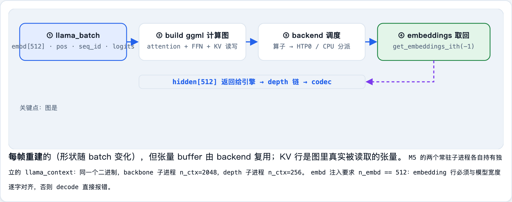
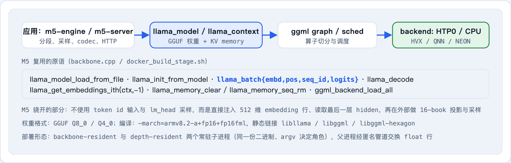
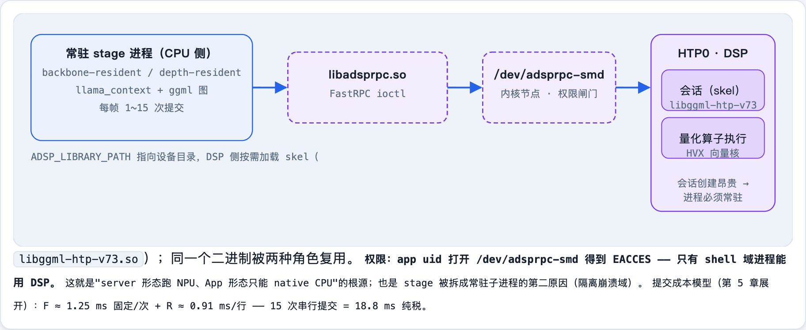
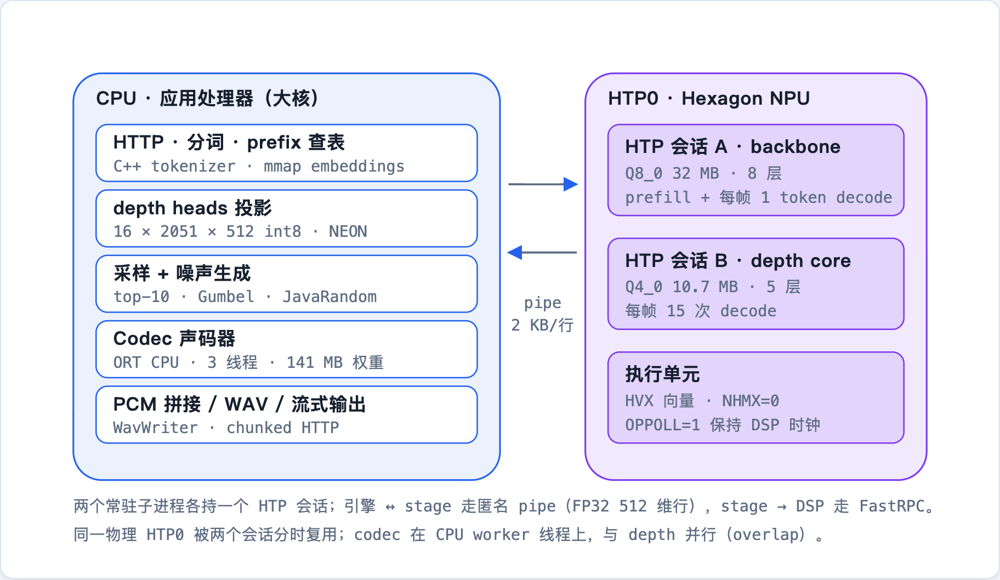
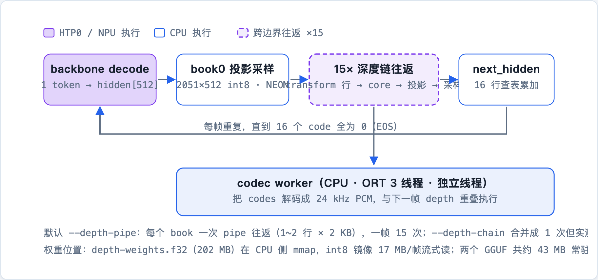

# M5-TTS 端侧推理实战（02）｜从 llama.cpp 到 Hexagon HTP：图、KV 和设备边界

开源仓库：[wangyifan2018/llama.cpp](https://github.com/wangyifan2018/llama.cpp) · [M5-TTS 代码与运行说明](https://github.com/wangyifan2018/llama.cpp/tree/master/examples/m5-tts)

理解 M5 复用了哪些 llama.cpp 机制，以及哪些计算依旧留在 CPU。

## 第 2 章 · llama.cpp 推理框架解剖：我们到底复用了什么

M5-TTS 并不是 llama.cpp 原生支持的模型。这一章讲清楚这个推理框架的分层与一次 decode 的完整生命周期——以及"借壳"注入 embedding 行那一招为什么成立。

**本章目标**

- 能画出一次 `llama_decode()` 从 batch 到 hidden 的完整生命周期
- 理解 ggml 计算图"先描述、后执行"的两阶段，以及 backend 调度在其中做的事
- 知道 KV cache 的 memory 接口与量化块格式，能算一笔简单的带宽账

### 2.1 一次 decode 的生命周期

llama.cpp 的推理入口只有两个：`llama_decode()`（一条 batch 走一遍）和它包裹的 **build → schedule → compute → read** 四步循环。M5 每帧都在走这个循环，只是喂进去的不是 token：

*图 2-1　一次 decode 的生命周期。M5 把 token id 留空、只填 `embd`，于是标准 decode 路径免费提供了 KV cache、后端调度与量化。*

### 2.2 计算图：先描述，再执行

ggml 的核心设计是**两阶段**：先把这一步要做的全部算子描述成一张 `ggml_cgraph`（节点 = 算子，边 = 张量），再由 backend 按拓扑序执行。这件事有两个容易被忽视的后果：

- **图的形状决定成本。**attention 要读多少行 K/V，是写进图形状里的——这正是第 11 章 KV pad 实验的机制：pad 从 256 缩到 32，等于每步少读被掩蔽的 K/V 行；代价是 `n_kv` 档位变多、 计算图重建次数翻倍（内存 vs 带宽的交易）。
- **后端是"设备的抽象"。**ggml_backend 把算子分派给 CPU / HTP / 其他设备；M5 通过 `ggml_backend_load_all()` 从 `LD_LIBRARY_PATH` 加载 Hexagon 后端（`libggml-hexagon.so` 等）， 之后整张图提交给 HTP0 常驻执行。两个 stage 进程 = 两份独立的 backend 会话。

### 2.3 KV cache 与 memory 接口

上下文状态不在模型里，在 `llama_context` 的 memory 里：按位置（pos）索引的 K/V 行。 M5 每次新请求用一条 `count == -1` 的管道消息触发整体清空（`llama_memory_seq_rm`）， prefill 前缀缓存则复用"整句前缀 + 少量行"这段 KV（第 7 章图 7-2 讲了它的协议形态）。 type_k / type_v 保持 **F32** 是实验换来的结论：KV 精度比权重精度敏感得多，f16 KV 会让 codes 漂移（第 6 章 6.1 节）。

### 2.4 量化块：Q8_0 与 Q4_0 的带宽账

| 格式 | 块结构 | 每权重位数 | 本工程用途 |
|----|----|----|----|
| Q8_0 | 32 权重/块 · int8 + fp16 scale | ≈8.5 | backbone（8 层，≈32 MB，常驻 HTP0） |
| Q4_0 | 32 权重/块 · int4 + fp16 scale | ≈4.5 | depth core（5 层，≈10.7 MB，常驻 HTP0） |
| F32 查表 | 无块（embedding 表） | 32 | heads 权重 202 MB，留 CPU 侧 mmap + int8 镜像 |

块量化的意义是**带宽**而非算力：dequant 在算子内核里即时完成，CPU/NPU 少搬多少字节才是收益。 这也是"量化一分钱都拿不到"案例（第 11 章 11.5 节）的机制伏笔：当算子是调度/延迟受限而不是带宽受限时， 权重体积腰斩不改变时间。

### 2.5 embd 注入：借壳的标准路径

*图 2-2　llama.cpp 分层与 M5 的复用点。这里最有教学价值的一招是 `llama_batch.embd`：把自定义向量直接喂进标准 decode 路径，从而免费获得 KV cache、后端调度与量化支持。*

`backbone.cpp` 用 `llama_model_load_from_file()` 载入 GGUF，检查 `n_embd == 512`， 用 `llama_context_default_params()` 设 `embeddings=true`、`type_k/type_v=F32`、 `n_ctx=2048`（depth 子进程 256），然后构造一个**不带 token 字段**的 `llama_batch`： 只填 `embd`（512 维浮点行）、`pos`、`seq_id` 和 `logits`（只请求最后一行）。 `llama_decode()` 之后用 `llama_get_embeddings_ith(ctx, -1)` 取回最后一层 hidden。

### 2.6 没有复用的部分

- **lm_head / logits**：M5 的"词表"是 16 个 book 各 2051 类，投影矩阵自己拿在手里（`m5_depth_heads.h`）， 所以只请求最后一行的 embeddings，不做标准 logits 采样。
- **tokenizer / sampling API**：C++ 侧自带分词与 Gumbel 采样，因为采样顺序（JavaRandom LCG） 是位精确门禁的一部分。
- **llama-server**：m5-server 是独立的 httplib 实现，端点面向 TTS（`/v1/audio/speech` 等）。

本章要点 llama.cpp 给 M5 的不是"跑一个新模型"，而是一组**可注入的原语**：embedding 进、hidden 出， 中间的 KV / 调度 / 量化全部继承。代价是要懂它的生命周期——图的形状、KV 的行数、块的带宽， 每一样都会变成后面的优化变量。

## 第 3 章 · HTP 后端：FastRPC、HVX 与 NPU / CPU 的边界

"模型跑在 NPU 上"这句话对 M5-TTS 只对了一小半。这一章讲清楚 DSP 的调用链、计算归属，以及每帧 15 次跨边界往返的真实结构。

**本章目标**

- 能画出从用户态进程到 Hexagon DSP 的 FastRPC 调用链，解释为什么 App 形态拿不到 NPU
- 说出六个模块各自落在 CPU 还是 HTP0，以及为什么这样切
- 理解"两个 HTP 会话分时一个 NPU"与每帧 15 次往返的结构含义

### 3.1 FastRPC：从用户态到 DSP

HTP（Hexagon Tensor Processor）不是一块"插上就能用"的加速卡，它是一组通过 **FastRPC** 远程过程调用的 DSP 服务。调用链是：

*图 3-1　FastRPC 调用链。FastRPC 的"每次提交都有固定开销"直接决定了 depth 的成本模型形状，也是"15 步压成 2 步"这一思路的成本依据。*

### 3.2 计算归属全景

真正跑在 HTP0 上的只有**两个 transformer**：backbone（8 层 Q8_0，32 MB）与 depth core（5 层 Q4_0，10.7 MB），合计约 43 MB 权重常驻。 **heads 投影、采样、噪声生成、codec 声码器、PCM 输出全在 CPU。**

*图 3-2　CPU 与 HTP0 的计算归属。注意"模型在 NPU"只覆盖了 43 MB 权重；每帧最重的 16 路 heads 矩阵乘和整个声码器都在 CPU。*

### 3.3 为什么这样切

**① transformer 归 NPU**

backbone / depth core 都是规则 GEMM，权重小（32 MB / 10.7 MB）可常驻 HTP，每层都能被 llama.cpp 的 ggml-hexagon 后端整图提交。HVX 向量单元擅长这个。

**② heads 留 CPU**

`depth-weights.f32` 是 202 MB 查表型权重，每步只取 1–2 行；CPU 侧 mmap + per-row int8 镜像（17 MB/帧流式读）+ NEON 更划算。带宽特征明显：int8 后 heads 快 2.5×。

**③ codec 留 CPU**

ONNX Runtime 图，含自写 `m5::Snake` 自定义算子，走 CPU EP（3 线程）。它不是 GGUF，也进不了 ggml-hexagon 的图。

**④ 两个进程，一个 NPU**

backbone-resident / depth-resident 是同一二进制的两个常驻子进程，角色由 argv 决定；各自一个 HTP 会话，分时复用同一 HTP0。拆开是为了 KV 隔离、分别调量化与 env。

### 3.4 一帧内的 15 次跨边界往返

引擎 ↔ stage 一行 FP32 512 维 = 2 KB。默认 `--depth-pipe` 下，每个 book 都要「CPU 构造 transform 行 → 送 HTP0 跑一步 depth core → 回 CPU 投影 2051 类 → 采样」，**一帧 15 次**。`--depth-chain` 能把整条链搬进 stage、一次往返，但实测打平；`m5_ring` 共享内存反而更慢——瓶颈从来不是 IPC 次数。

*图 3-3　一帧的数据流。虚线框是 CPU↔NPU 交替区，也是日志 §14 里草稿无法跨越的那段依赖。*

### 3.5 三个值 2.2 倍的后端旋钮

ggml-hexagon 后端有三个环境旋钮，全部写进了部署脚本（见 `deploy.sh` 头部注释）：

**`GGML_HEXAGON_NHMX=0`**

HMX 是 Hexagon 的矩阵扩展，按理更适合 GEMM——但本部署的形状是 512 宽、每次 1–2 行的 GEMV，实测走 HMX 反而慢，关掉后走 HVX 向量路径。旋钮的价值随硅与形状变，抄配置之前先量。

**`GGML_HEXAGON_OPPOLL=1`**

保持 DSP 时钟轮询。不设时 DSP 在两次提交之间掉频，实测差 **2.2×**——这是本项目捡到的最大一笔"免费"收益。后续测量还发现它只改墙钟、不改 CPU 总量（省的是等待，不是算力）。

**`POWER_MODE=sustained_high_performance`**

告诉电源管理"这是持续负载"。与 OPPOLL 一起构成 DSP 侧的稳态环境；漏掉任何一个，NPU 结论都不可复现。

**为什么是环境变量**

三个旋钮都属于"不改代码、只改部署"的层。它们的教训是通用的：**先把执行环境的税交齐，再谈 kernel 优化**——顺序反了会把环境噪声当成算子瓶颈。

### 3.6 两个容易误解的点

**两个 HTP 会话 ≠ 两个 NPU**

都是 HTP0，只是两个独立的 llama 上下文（各自 KV、各自量化）。它们分时复用同一物理 DSP。

**App 形态拿不到 HTP**

OS 对 app uid 封了 `/dev/adsprpc-smd`（EACCES），JNI 版只能全 CPU 跑（RTF ~0.79–0.90）。只有 shell 域启动的 m5-server 才能用 NPU——所以全书的 NPU 结论都只适用于 server 形态。

由此决定的一个工程结构 backbone 与 depth 被拆成两个常驻子进程，不是为了"并行"，而是两个边界条件逼出来的： HTP 上下文初始化以秒计（一次进程启动就吃掉整段预算），且一旦 DSP 侧崩溃， 进程级隔离才不会把整个 server 带走。**先量清楚启动成本与崩溃域，再决定进程拓扑**—— 这是端侧推理里最容易被忽略的一层设计。

下一篇：第 3 篇《先测量，再建模：RTF、质量门禁与 depth 成本》。
