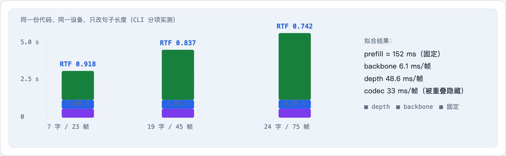
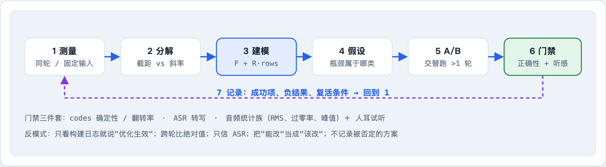
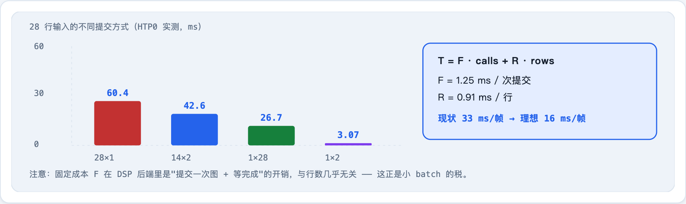
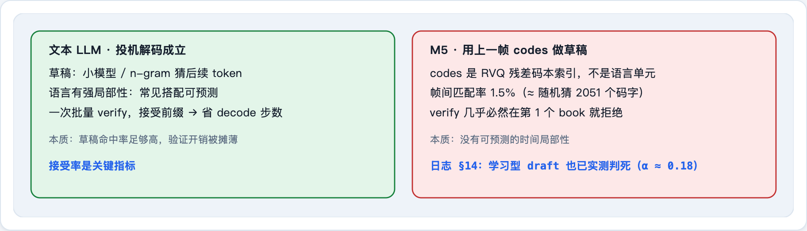

# M5-TTS 端侧推理实战（03）｜先测量，再建模：RTF、质量门禁与 depth 成本

开源仓库：[wangyifan2018/llama.cpp](https://github.com/wangyifan2018/llama.cpp) · [M5-TTS 代码与运行说明](https://github.com/wangyifan2018/llama.cpp/tree/master/examples/m5-tts)

把端到端计时、音质回归和提交微基准放到同一套实验方法里。

## 第 4 章 · 先学会测量：RTF、分层埋点与质量门禁

大多数"优化失败"，其实是一开始就量错了。

**本章目标**

- 知道 RTF 什么时候会骗人，并能用"固定成本 + 每帧成本"拆解它
- 能搭出端到端 / 分项 / 微基准三层可观测性
- 理解为什么 TTS 优化必须带质量门禁，以及门禁各自的盲区

### 4.1 RTF 的定义与三个陷阱

`RTF = 生成耗时 ÷ 生成音频时长`。小于 1 表示"比实时快"。它直观、便于对比，但有三个坑：

1.  **短句惩罚**：模型有固定的 prefill / codec 预热 / 首批调度成本，音频越短摊不掉。实测 7 字句 RTF 0.918，19 字 0.837，24 字 0.742——同一份代码，只因为句子长度不同。
2.  **热漂移**：连续压测让 SoC 升温，同一代码 RTF 从 0.75 慢慢漂到 0.87、0.91。跨轮绝对值不可比，必须**同轮交替 A/B**（A→B→A→B）。
3.  **口径不一致**：CLI 单次进程 vs server 常驻进程、wav 全量 vs pcm 流式、是否包含首次 codec prime，都会改变分子。

*图 4-1　RTF 随句长下降不是"模型变快了"，而是 152 ms 固定成本被更多帧摊薄。长句时 depth 占墙钟约 83%，这才是真正该盯的地方。*

可迁移的做法 拿到一条耗时曲线，先做**线性拟合**：`T(N) = 固定开销 + 每单位成本 × N`。 截距指向冷启动 / prefill / 图初始化，斜率指向真正的逐 token（逐帧）热路径。 优化截距只对短请求有意义，优化斜率才对长请求有意义——两者 often 需要完全不同的手段。

### 4.2 三层可观测性

| 层 | 工具 / 接口 | 回答什么问题 | 本项目实例 |
|----|----|----|----|
| 端到端 | `X-M5-RTF / Elapsed-S / First-Pcm-S / Frames`、`GET /metrics` | 用户实际感受到多快？分布如何？ | wav 响应带头；pcm 流式头提前定稿，只能靠 `/metrics` 与客户端实测 |
| 分项 | `X-M5-Backbone-S / Depth-S / Codec-S`、`M5_HEAD_STATS=1` | 时间花在哪个阶段？ | 发现 `g_heads_s` 双计 bug；测出 heads 13.4 ms/帧 |
| 微基准 | `depth_batch_bench.cpp`、`--dump-codes`、`M5_ZERO_TRANSFORM=1` | 机制是什么？依赖有多强？ | 拟合提交成本模型；量化"串行依赖敏感度" |

这里有个值得记住的设计细节：HTTP chunked 响应在第一个分块发出时就已经把 headers 定稿， 而合成统计要等整段结束才知道，**所以流式响应天生无法把最终统计放在响应头里**。 本项目为此加了 `/metrics`：服务端留存最近 64 次请求的 JSON 明细与分位数， 并提供 Prometheus 文本格式；控制台在合成完成后拉取一次，用 `last.id` 认领本次记录， 把 `≈` 估算值替换为服务端权威值。

*图 4-2　本项目反复使用的决策循环。第 7 步最容易被跳过，却决定了下一次不会重走死路。*

### 4.3 质量门禁：为什么"codes 不一样"不等于"错了"

自回归生成是**混沌系统**：任何 1-ulp 的数值扰动都可能让采样落在另一个 token 上，之后轨迹完全分叉。 因此门禁不是"逐位一致"，而是分层：

**① 数值正确性**

看**首帧**。改动若引入系统性误差，第 0 帧就会翻。heads int8 首帧 0/16 翻转，说明量化无偏。

**② 轨迹分叉可解释**

帧 2 起通过 `next_hidden` 反馈放大到 ~90% 翻转——这是"同分布另一条采样轨迹"，同级于换随机种子。

**③ 语义与听感**

ASR 两句全对、RMS/过零率/峰值同族、模式内确定性 0% 翻转。必要时再加人耳试听。

**④ 什么时候必须否决**

backbone Q4_0 让音频短 16%（语速变快），ASR 依然全对——只有耳朵能抓到韵律漂移，最终保持 Q8。

### 4.4 瓶颈分类学（后面所有优化都对应其中一类）

| 类型 | 典型症状 | 本项目对应 | 有效手段 |
|----|----|----|----|
| 带宽受限 | 耗时 ∝ 权重字节数，算力没吃满 | heads 每帧 34 MB 流式读取 | f16 → int8 量化、权重驻留 |
| 提交开销 | 同样行数，调用次数越多越慢 | depth 1.25 ms/次固定成本 | 批量化、算子融合、忙轮询 |
| 串行依赖 | 并行/批量会改变输出语义 | 15 步 book 链、帧间 next_hidden | 只能改模型图（学习型草稿已判死，见第 5 章） |
| 冷启动 | 第一个请求特别慢 | prefill / ORT kernel / codec 图初始化 | 启动预热、跨请求状态缓存 |
| 重复计算 | 同音色每次都重算同一段 | 共享 conditioning 前缀、codec primer | KV 前缀缓存、prime 状态复用 |
| 资源竞争 | 两个任务并发时都变慢 | codec 与 depth 同时跑，depth 慢 ~20% | 评估净收益，而非单任务最优 |

判别技巧 想知道是不是带宽瓶颈，**改权重的字节数看看耗时是否按比例变**。 depth 权重 Q8_0(21 MB) → Q4_0(10.7 MB) 只快 9%，若真是带宽受限应该接近翻倍——由此判定 depth 是"提交开销 + 计算主导"， 于是"继续降位量化"这条路被直接关掉。这个判别法比看 profiler 百分比更可靠。

### 4.5 案例：一次"提速后音质变差"的完整调查

这一节是 4.3 分层门禁的实战版。Serena 换上 Flash Attention 融合内核后，个别字出现疑似破音。 调查分四步，每步只回答一个问题：

1.  **复现并保住基线。** 同一文本、音色、种子重新生成，两份产物都保留。听感是验收条件，RTF 只描述吞吐。
2.  **按算子形状拆 profile。** 按 DSP 批次形状分组、只比较同形状的 decode（旧 profile 里 1,820 个 80 算子批次）： FP32 普通注意力 ≈ 2.65 ms/decode，FP16 普通 ≈ 2.60–2.65，FP16 Flash ≈ 1.92——先确认 Flash 真的走了 HVX，提速是真的。
3.  **把"生成"与"解码"隔离。** 分别保存基线与 Flash 的 codes：同一 attention 配置跨 codec 的 codes 完全一致， 排除 PCM16 削顶与分块边界——问题出在**生成轨迹**，不在声码器。
4.  **同一组 codes 盲听定位。** INT8 版比 FP32 版更明显：量化边界放大了轨迹差异，但轨迹本身已经变了。

人耳证据与判决 三条文本各两份、a/b 顺序打乱的双盲试听：用户指出第 3 组（车站播报）的 `3a` 差——揭晓后 3a 正是融合内核版。 KV 精度没变、codes 之外的客观指标全对，但**只换 attention 实现也能被听出来**。 按 4.3 节等价性分层判决：第 ③ 层不通过即否决，与第 ①② 层通过与否无关。 样本量小（3 组、1 组被指出），所以结论是"不进入生产"，不是"所有文本都能听出差异"—— 分层门禁的价值恰恰在于：它规定了**哪一层有一票否决权**。 **音质验收 ≠ 性能验收**

两条链路分开走：性能看 elapsed_s 与每帧成本；音质看 codes 一致性 → ASR → 盲听。任何"客观指标全对"都不能替代最后一层。

**归因一次只动一个变量**

本案例曾同时动过 KV 精度与 kernel 实现，听感无法归因；退回"保 FP32 KV、只换 kernel"后证据才干净。profile 里按形状分组，而不是按时间轴平均。

## 第 5 章 · 成本模型：把 15 步串行看透

本章是整门课的核心——用一个微基准，把"能不能批量化"变成可计算、可证伪的问题。

**本章目标**

- 会用 bench 数据拟合"固定提交成本 + 每行成本"，并算出理论加速上限
- 理解为什么理论 2.1× 拿不到、六条压缩路径各自怎么被排除，以及为什么连训练草稿也不行（5.3 与日志 §14）
- 能把这里的推理迁移到 LLM 的投机解码 / Jacobi decoding 讨论

### 5.1 一次调用多少钱

`depth_batch_bench.cpp` 在 HTP0 上把 28 行输入拆成四种形状，各跑多轮取中位数：

| 形状                           | 总耗时  | 含义           |
|--------------------------------|---------|----------------|
| 1 × 28（一次提交 28 行）       | 26.7 ms | 批量的理想情况 |
| 14 × 2（14 次提交，每次 2 行） | 42.6 ms | 接近现状       |
| 28 × 1（28 次提交，每次 1 行） | 60.4 ms | 最碎的提交方式 |
| 1 × 2（单次 2 行基线）         | 3.07 ms | 校准固定开销   |

用 `T = F·调用次数 + R·行数` 拟合，得到 **F ≈ 1.25 ms/次提交，R ≈ 0.91 ms/行**。 于是现状（一帧 15 次调用、16 行）≈ `15×1.25 + 16×0.91 ≈ 33 ms`； 理想批量（1 次调用、16 行）≈ `1.25 + 16×0.91 ≈ 16 ms`。 **理论上限约 2.1×**（只算 depth core 的提交开销）。**但这个数字后来被两次修正**： 算上 heads 投影后 depth 阶段天花板只有 1.78×，而且 codec 与 depth 并行， 单独提速会被 `max()` 吃掉；日志 §14 又证明学习型草稿的 α 上界只有 0.18， 连这个 1.78× 都拿不到。详见本章 5.3。

*图 5-1　提交次数比行数更贵。把 28 行拆成 28 次提交，比一次提交慢 2.3 倍。*

### 5.2 动手：自己推一遍理论上限

用原计算器的默认值演算一次：70 帧、每帧 15 次提交和 16 行，固定成本 F=1.25 ms/次，每行成本 R=0.91 ms。

    当前 depth = 70 × (15 × 1.25 + 16 × 0.91) ms ≈ 2.33 s
    理想合批 depth = 70 × (1.25 + 16 × 0.91) ms ≈ 1.11 s
    估算 RTF = (152 + 70 × 6.1 + 2,331.7) / (70 × 80) ≈ 0.520
    depth 理论加速上限 = 2.33 / 1.11 ≈ 2.11 倍

模型假定 codec 耗时被重叠隐藏。把提交次数从 15 改为 1 即可复算。这是教学估算，实际合批还受到第 5.3 节的码本依赖约束。

### 5.3 六条"精确压缩"路径，逐条被实验关掉

| 路径 | 想法 | 证伪证据 | 结论 |
|----|----|----|----|
| ① 哑输入批量 | 把 15 步合成 1 次，transform 行先用零占位 | `M5_ZERO_TRANSFORM=1` 让 codes 翻转 **99.6%**（首帧 15/15 全翻），音频 70→500 帧发散不终止 | ❌ transform 行承载语义与 EOS 决策 |
| ② 投机草稿 | 用上一帧 codes 做草稿，一次批量 verify | 帧间 codes 匹配率仅 **0~1.5%**（lag 1-5 都是），近似随机 | ❌ codec codes 没有时间局部性 |
| ③ Jacobi 迭代 | 并行猜 15 步再迭代收敛 | 依赖沿 15 步链传播，收敛需 O(15) 轮 | ❌ 比串行更差（分析排除） |
| ④ 跨帧批量 | 把多帧一起 decode | `next_hidden` 反馈给下一帧 backbone 输入 | ❌ 帧间被自回归锁死 |
| ⑤ 后端算子融合 | 减少 op 数量 | OPFUSION 0 vs 1 只差 5%（44.6 vs 42.5 ms），深度图太小 | ❌ 已见底 |
| ⑥ 减少 IPC 往返 | `--depth-chain`：16 次 pipe 往返 → 1 次 | 逐位一致（宿主 200 组随机输入 0 mismatch）；但实测 depth 4.15 vs 4.08 s（**-1.5%**） | ⚠ 正确但没收益：瓶颈不是往返 |

*图 5-2　同样是"草稿 + 批量验证"，在 LLM 上成立、在 codec codes 上不成立。差别不在工程，而在数据分布是否有可预测性。*

最重要的结论 **理论上限 ≠ 可达上限**。2.1× 的收益是真的，但拿不到它的原因是**模型语义**：15 步串行是训练出来的依赖结构，不是实现偷懒。 任何"把 15 次合成 1 次"的精确方案都必须先回答：transform 行里的 code 依赖怎么办？ 曾经的答案是「训练一个小草稿模型做预测」，但日志 §14 用 960 帧官方 ONNX 轨迹把这条路也关掉了： 可预测性沿 15 步链结构性衰减，α 上界 ≈0.18 远低于盈亏平衡 0.72（图 5-2 与第 3 章图 3-3 就是草稿跨不过去的那段依赖）。 现在只剩重训 depth 头支持并行出多 book——那是改模型图、需要原始训练数据的另一个项目。

下一篇：第 4 篇《优化复盘：量化、数据搬运与流水线重叠》。
