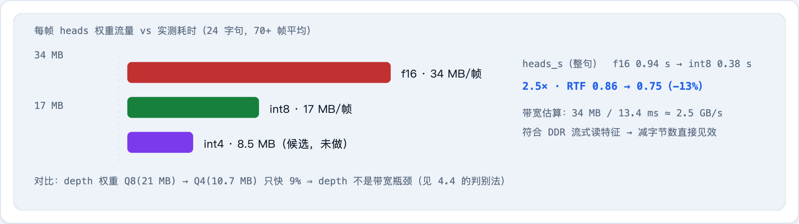
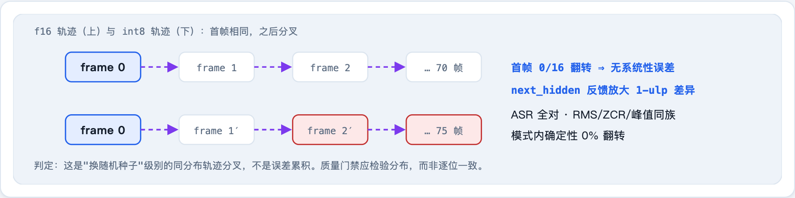
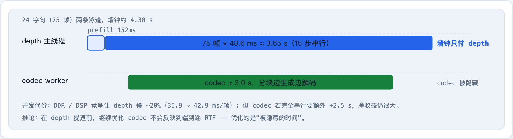
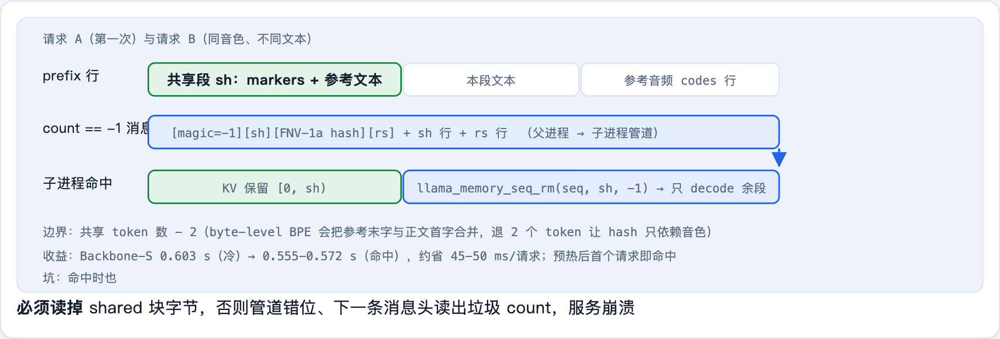

# M5-TTS 端侧推理实战（04）｜优化复盘：量化、数据搬运与流水线重叠

开源仓库：[wangyifan2018/llama.cpp](https://github.com/wangyifan2018/llama.cpp) · [M5-TTS 代码与运行说明](https://github.com/wangyifan2018/llama.cpp/tree/master/examples/m5-tts)

比较压缩权重、减少搬运、并行执行和复用前缀各自能省下什么。

## 第 6 章 · 优化复盘（上）：让数据搬运变便宜

量化、算子融合、编译期验证——这一组优化的共同敌人是"字节数"和"扫描次数"。

**本章目标**

- 会用"权重流量 × 带宽"估算 GEMV 耗时，并据此判断量化能省多少
- 理解 f16 宏事故、int8 混沌分叉、Q4 被耳朵否决这三件事各自的方法论含义
- 区分钟算式优化与提交开销型优化

### 6.1 f16：一个"优化了但根本没编译进去"的故事

depth heads 每帧要做 16 次 `512×2051` 的 GEMV，权重是流式读取的。 最初的 f16 内核守卫写成了 GCC 风格宏 `__ARM_FEATURE_FP16`，而 NDK clang 19 实际定义的是 `__ARM_FEATURE_FP16_VECTOR_ARITHMETIC` / `__ARM_FEATURE_FP16_FML`。 结果宏从未匹配、f16 是死代码，而构建日志与一次 objdump 检查都误报"已生效"，于是留下"RTF 持平"的假象。

修复动作有两步：改对宏名，并在 CMakeLists 里全局加 `-march=armv8.2-a+fp16+fp16fml`； 验证方式是**反汇编数指令**（确认 128 条 `fmlal` 真的出现），再做同种子交替 A/B： 每帧 57.3 → 48.3 ms（**-16%**），5/5 测试句 RTF 改善 11~13%。

教训 编译期优化必须以**产物**为准（反汇编 / 符号 / 计时），不能以构建日志或"代码写对了"为准。 宏名要按实际编译器的特性宏写；跨平台 SIMD 路径尤其容易静默回退到标量实现。

### 6.2 heads int8：带宽减半，heads 快 2.5 倍

埋点显示 heads 每帧约 13.4 ms，而每帧要流过约 34 MB f16 权重（投影 + projected 块）， 折算带宽约 2.5 GB/s —— **这是典型的内存带宽瓶颈，算力几乎没参与**。 于是做 per-row 对称量化：每行 512 个 float 求 `max|w|`，`scale = max/127`， 存成 int8 + 一个 float scale；GEMV 用 NEON 把 int8 解包后以 f32 累加，最后乘回 scale。 注意 **只量化权重、输入仍保持 f32**，避免激活量化的误差叠加。

*图 6-1　同一个"量化"动作，在 heads 上是特效药，在 depth 上却几乎无效。判别依据是耗时是否随字节数按比例变化。*

量化还带来一个必须讲清楚的现象：**codes 从第 2 帧起翻转 ~90%**。别急着判死刑——见下面这张图。

*图 6-2　自回归系统的数值扰动会被反馈环放大。门禁要看首帧（数值正确性）与最终听感（语义正确性），中间 codes 逐位相等既不可能也不必要。*

### 6.3 什么时候量化必须被否决：backbone Q4_0

用 host 端 `llama-quantize --allow-requantize` 把 backbone 从 Q8_0(32.4 MB) 压到 Q4_0(17.1 MB)， 同轮交替 A/B 的数据很漂亮：`backbone_s 0.632 → 0.495（-21%）`，depth 也因 DDR 竞争减少快了 15%， **两版 ASR 全对**。但音频时长从 5.90 s 缩到 4.94 s（**-16%，语速变快**）——这是韵律漂移。 人工试听后决定**保持 Q8_0**：TTS 的自然度优先于这部分 RTF，且 backbone 只占墙钟约 14%。

方法论 ASR 检查的是"说了什么"，韵律检查的是"怎么说"。生成式任务的指标天然偏向内容， **凡是改动会影响采样分布的优化，都要有感知层验收**（这里是人耳；图像任务里是视觉检查/感知指标）。 同时要算清收益占比：为了 14% 的环节去牺牲全局听感，通常不划算。

### 6.4 codec：三步量化 + 一次"反直觉"的算子融合

| 动作 | 效果 | 原理 |
|----|----|----|
| CT → MatMul 改写、权重动态 int8 | 模型 362 → 141 MB；codec 7.49 → 4.68 s（115 帧句） | 让算子落到 ORT 的量化快速路径 |
| 融合 Snake 激活为自定义算子 | RTF 0.898 → 0.837 | `snake(x)=x+c·sin(αx)²` 原图是 Mul→Sin→Pow→Mul→Add 五遍全量扫描，Sin 单核占 codec ~14%；融合后用 9 次多项式正弦单遍算完（误差 ~2e-6） |
| ORT 线程数 A/B | 2/3/4 线程 = 3.56 / 2.84 / 3.20 s → 3 最优 | 核数继续增加会因调度/缓存竞争变慢 |

反直觉但已实测 把 Snake 链用**图级多项式展开**成 13+ 个标准算子反而更慢——每多一个算子就多一次全张量读写。 "算子数量少"不总等于快，**内存扫描次数**才是这里的成本。融合成单个自定义算子才能同时省扫描和 Sin。

另外两个死胡同也值得记：尾部 ConvTranspose 保留 fp32 只有 12.78 vs 12.75 dB 的无差别收益； 对 QK^T / AV 这类"激活 × 激活"的 MatMul 做量化会掉 1.3 dB（Softmax 敏感），因此动态量化时必须把 17 个这样的节点排除。

### 6.5 小结：怎么判断"该不该量化"

1.  先测**流量与耗时是否成比例**（改权重的位宽做 A/B），确认是带宽瓶颈；
2.  若是，优先量化**流式读取的大权重块**，且尽量只量化权重、保留激活精度；
3.  用首帧一致性 + ASR + 感知验收三层门禁，别用逐位 codes 当标准；
4.  算清该环节在总墙钟的占比，收益天花板 = 占比 × 提速比例；
5.  如果环节被流水线重叠隐藏（codec），现在优化它**不会**反映在端到端 RTF 上——等主瓶颈降下来再做。

## 第 7 章 · 优化复盘（下）：让时间重叠、让重复消失

这一组优化不改变数学，只改变"什么时候做、做几次"。

**本章目标**

- 理解后端轮询模式为什么能带来 2×，以及系统化调参的正确姿势
- 会用流水线重叠、分块策略、冷启动预热分析首包延迟
- 理解 KV 前缀缓存的协议设计与"字节对齐"这类系统级 bug
- 能一眼说出本项目每个成功项 / 负结果属于哪类杠杆

### 7.1 后端旋钮：一次环境变量值 2.2 倍

`ggml/src/ggml-hexagon/ggml-hexagon.cpp` 暴露了一组 HTP 后端参数，默认值并不适配这个 "每帧 15 次极小图提交"的工作负载。其中 `GGML_HEXAGON_OPPOLL`（默认 0）决定是否**忙轮询** DSP 队列完成：设为 1 时 `dspqueue_read` 超时为 0（不睡眠等中断）， 设 0 时阻塞等待 `DSPQUEUE_TIMEOUT`。小图高频提交下，阻塞等待的代价被放大：

| 配置（depth-bench, ms） | 28×1 | 14×2 | 1×28 | 结论 |
|----|----|----|----|----|
| **baseline OPPOLL=1 / NHMX=0** | **60.6** | **42.6** | **26.8** | 基准 |
| OPPOLL=0 | 111.3 | 69.7 | 31.4 | 慢 ~1.8×，必须保留 |
| NHMX=1 | 61.4 | 42.8 | 26.8 | 无差 |
| OPBATCH=16 / 64 | 76.3 / 64.6 | 52.6 / 44.7 | 27.1 / 26.7 | 更慢 |
| OPQUEUE=1 / 2 | 60.6 / 61.0 | 42.7 / 42.9 | 26.7 / 26.7 | 无差 |
| OPFUSION=0 | 64.6 | 44.7 | 27.1 | 略慢（默认 1 正确） |

端到端实测同句 **RTF 1.62 → 0.75（2.2×）**。更重要的是运维结论：这类"隐式配置"丢了会 **静默慢一倍**，且不会报错。因此项目把 `GGML_HEXAGON_NHMX=0 GGML_HEXAGON_OPPOLL=1` 写死进 `deploy.sh` 的启动环境，而不是靠某次终端里的 `export`。

可迁移的做法 后端旋钮要**成表扫描、同轮对照、把赢家固化到部署脚本**。 单参数调优很容易把噪声当收益；这里连 `POWER_MODE / HOSTBUF / NHVX / OPQUEUE 1-32` 都扫过， 结论落在 ±1% 噪声内，才敢说"当前配置已最优"。

### 7.2 流水线重叠：把 codec 藏在 depth 后面

*图 7-1　重叠（overlap）是系统工程里最划算的一招：不改变任何计算量，只让两条依赖链并行。判断它是否值得，要比较的是净墙钟，而不是单条泳道的速度。*

### 7.3 分块策略与"固定开销"的第二次出现

codec 是带递归状态的 ONNX 会话，按 chunk 批量解码。chunk 越小首包越早，但每次 ORT Run 有固定开销； 于是按请求类型分策略：

**流式 pcm：first=2, chunk=4**

首包 0.285 s。曾试过 1 帧首块，期望再省一个 depth step，实测**首包 0.51 s 反而更慢**——codec 单帧调用的固定开销盖过了收益。

**完整 wav：first=4, chunk=16**

反正听不到过程，大 batch 把 ONNX 调用从 18 次降到 5 次。

**启动预热**

服务启动后跑一句丢弃模式的短合成，把 backbone prefill、depth 图、ORT kernel 全部热身；首请求首包 0.58 → 0.29 s。启动多花 ~1.5 s，一次付清。

**WavWriter 三模式**

文件 / 内存 / 丢弃。wav 响应直接在内存拼 RIFF 头，pcm 流式只计数不落盘——去掉白做的磁盘 I/O。

规律 "更小的块 = 更低延迟"只在**固定开销小**时成立。任何带会话初始化、图提交、DMA 的调用都要先量它的固定成本， 再决定分块粒度。这与 5.1 的 `F` 是同一个概念，只是发生在 codec 层。

### 7.4 prefill 前缀 KV 缓存：一个协议级优化

同一音色的每次请求，prefix 的前半段（控制标记 + caption + 参考文本）完全一样，只有目标文本与参考 codes 后面的部分不同。 既然 backbone 是标准 llama.cpp context，就可以**保留共享段的 KV，只重算新增部分**。

*图 7-2　`count == -1` 预填充消息与 `llama_memory_seq_rm`。这是"用框架原生 KV 能力做应用级缓存"的典型范例。*

还有两个同类的"别重复做"：`Codec::restore_prime` 按参考 codes 的最后 8 帧缓存 codec 递归状态， 同音色第二次请求起跳过一次 primer ORT Run；`voices.json` 按 mtime 缓存，避免每请求重读解析。

### 7.5 传输与并发：正确 ≠ 更快

| 尝试 | 结果 | 为什么值得记 |
|----|----|----|
| `--depth-chain`：16 次 pipe 往返 → 1 次 | 逐位一致，但慢 1.5% | 证明瓶颈是权重带宽 / 提交开销，不是 IPC 延迟；协议仍保留为未来批量化落点 |
| `m5_ring` 共享内存环 | 比匿名管道慢 | futex 等待让 HTP 提交路径退化；"零拷贝"不必然更快 |
| 噪声预生成向量化 | 占比 ≤2%，且 JavaRandom 顺序敏感 | 收益不足以打破位精确约束；先量占比再决定要不要动 |
| 跨请求 KV / voice embedding 预计算 | \<2 ms | 文本不同无法复用；小项不值得增加复杂度 |
| 并发改造 `render_mutex` | 单用户场景无收益 | 优化要匹配真实负载，别为假想流量设计 |

### 7.6 全量卡片：每一个优化尝试

#### HTP env 固化 · 2.2×

RTF 1.62 → 0.75

OPPOLL=1 / NHMX=0 写进 deploy.sh，避免隐式配置丢失。

#### codec 三步量化 + Snake 融合 · 上线

RTF 0.898 → 0.837 · 362→141 MB

减扫描次数，融合 Sin 单遍多项式。

#### f16 heads（含宏事故修复） · -16%/帧

57.3 → 48.3 ms/帧

用反汇编验证编译期优化真的生效。

#### heads int8 · 2.5×

RTF 0.86 → 0.75（-13%）

带宽瓶颈；混沌分叉但 ASR 干净。

#### ORT 线程 = 3 · 定值

2/3/4 = 3.56/2.84/3.20 s

线程数不是越多越好。

#### 按请求 chunk 策略 · 上线

wav 4/16 · pcm 2/4

首包 0.285 s；wav ONNX 调用 18→5。

#### WavWriter 三模式 · 上线

零磁盘 I/O

内存拼 wav、流式只计数。

#### deploy.sh 一键部署 · 运维

env 固化 + 模型备份

设备重启后一条命令恢复。

#### 启动预热 · 上线

首包 0.58 → 0.285 s

丢弃模式合成一句，一次付清冷启动。

#### prefill 前缀 KV 缓存 · 上线

省 45-50 ms/请求

-1 协议 + seq_rm + BPE 边界 −2。

#### X-M5 分项头 + /metrics · 可观测

JSON + Prometheus

流式路径的唯一权威统计来源。

#### 工程小项集合 · 上线

mtime 缓存 / CORS / 错误处理

voices.json、Expose-Headers、pcm 预校验。

#### depth 15 步批量化（六路径） · 排除

理论 2.1×，实际不可达

transform 依赖 99.6% 翻转；帧间相关 1.5%。

#### HTP 旋钮 sweep · 已最优

OPPOLL 之外无增益

OPBATCH 更慢、OPQUEUE 无差。

#### backbone Q4_0 · 否决

快 21% 但音频短 16%

人耳抓到韵律漂移 → 保持 Q8。

#### depth 换更低量化 · 排除

Q8→Q4 只快 9%

证明非带宽瓶颈。

#### m5_ring 共享内存 · 更慢

futex 等待

零拷贝不等于低延迟。

#### 噪声向量化 / 跨请求 KV · 收益 \<2%

位精确约束 / \<2 ms

先量占比，再决定复杂度。

#### 学习型草稿 · 判死

α_oracle ≈ 0.18 ≪ 0.72 门槛

960 帧 ONNX：ridge / 核回归 / 单 code 扰动三组证据，见日志 §14 与第 5 章。

#### 并行资源让渡 / 旋钮重扫 · 证伪

48 次 A/B，无一快于默认

日志 §13：depth_s 与 codec 负载不相关；关 overlap 反 +43.9%。

#### codec 单独再优化 · 零收益

被 max(depth, codec) 吃掉

日志 §13：codec 变快而 depth 不变，端到端墙钟不动；除非与 depth 提速捆绑。

#### 重训 depth 头 · 待验证

一次前向出多 book

改模型图、需原始训练数据，已是另一个项目（见第 11.9 节）。

#### heads int4 · 小候选

17 MB → 8.5 MB 流量

门禁同 int8；预期每帧 -2~3 ms，收益有限但风险低。

下一篇：第 5 篇《上线之后：产品分块、热漂移与并发》。
