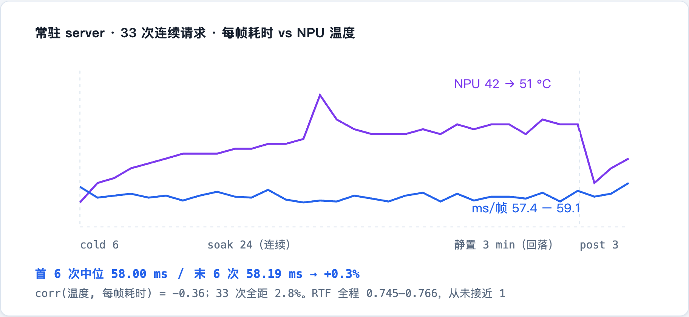
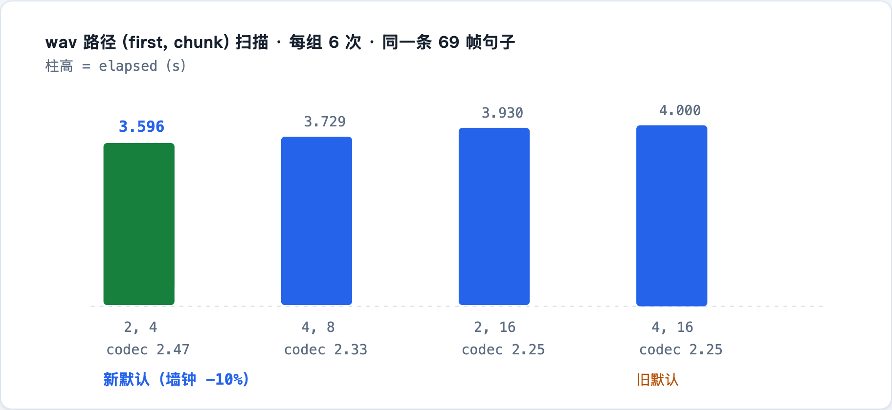
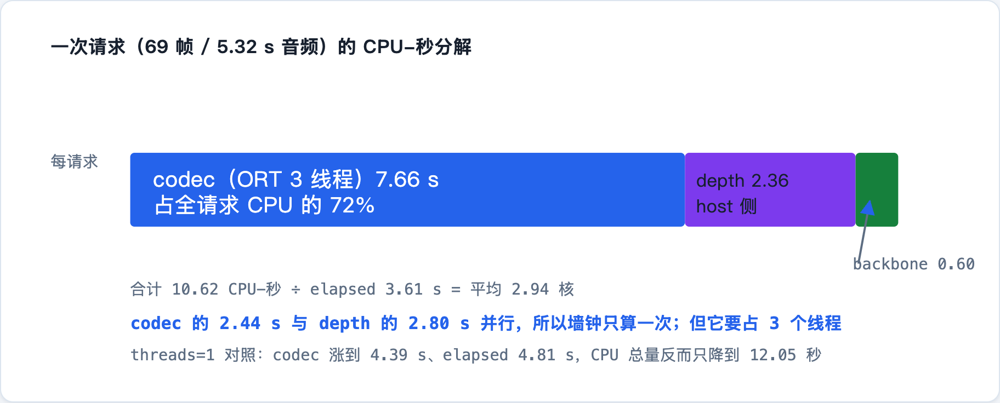
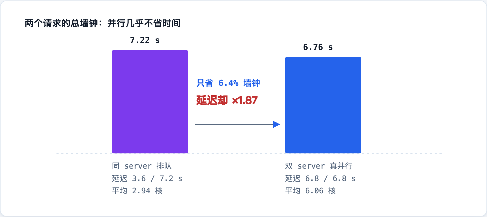
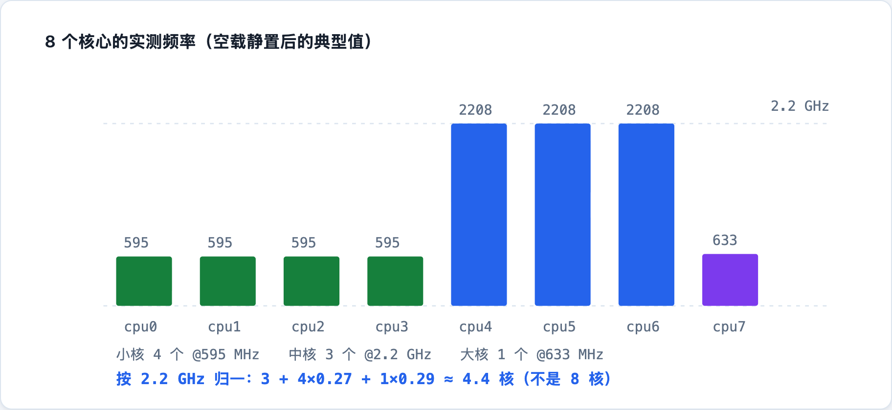

# M5-TTS 端侧推理实战（05）｜上线之后：产品分块、热漂移与并发

开源仓库：[wangyifan2018/llama.cpp](https://github.com/wangyifan2018/llama.cpp) · [M5-TTS 代码与运行说明](https://github.com/wangyifan2018/llama.cpp/tree/master/examples/m5-tts)

从 CLI 跑得快走到服务实际响应，考察分块、温度和 CPU 资源。

## 第 8 章 · 从实验室到产品：环境漂移与配置税

这一章的任务本来是「测热漂移」——把那个「同代码连续跑 RTF 0.75→0.91（+21%）」的旧结论坐实。结果测出两件事：**热根本不是问题**，而**产品路径一直比调优路径慢 8%**。前者教会你怎么读环境数据，后者值 10% 的墙钟。

**本章目标**

- 能区分「连续压测后变慢」的三种原因：真热漂移、升频滞后、测量对象不对
- 会设计一次已经排除环境税的 A/B（discard 热身 + 同轮交替 + 正逆序）
- 能发现并固化「同一份代码、两条路径不同参」这类配置税

### 8.1 热基线：温度上去了，时间没动

用常驻 server（真实产品路径）跑 33 次：静置 2 分钟后连续 6 次、再连续 24 次（占空比约 97%）、静置 3 分钟后 3 次。每次请求前后各采一次温度与频率。判据用 **ms/帧**，不用 RTF——分母会随输出长度变。

*图 8-1　紫线（温度）一路向上，蓝线（每帧耗时）原地不动。**温度升高不等于降频**——要看的是有没有跨过阈值。*

| 组 | ms/帧 min / 中位 / max | 首段 → 末段 | 温度 |
|----|----|----|----|
| server 33 次 | 57.42 / **57.93** / 59.06 | 58.00 → 58.19（+0.3%） | NPU 36.8→51.6 °C |
| CLI 12 次（对照） | 53.64 / **54.45** / 55.53 | 54.70 → 54.67（0.0%） | NPU 44.4→48.0 °C |

温度确实涨了：NPU +14.8 K、DSP +18.8 K、DDR +14 K，但 `shell_front` 只有 31–34 °C——整机在帮忙散热，单点温度远没到降频阈值（一般 80–95 °C）。静置 3 分钟后 NPU 从 46 回落到 37.6 °C。所以：

结论 在占空比 ~97%、连续 8 分钟、峰值 52 °C 的条件下**没有热降频**。「+21% 漂移」应标记为**环境相关、未复现**，不再当基线引用；真实的环境漂移量级是 **4%**（同一配置两次测到 3.977 vs 4.164 s），所以交替轮次的做法仍要保留。

### 8.2 意外：两条路径根本不同参

热基线里有一组数字对不上：server 每帧 57.9 ms，CLI 54.2 ms，**产品路径慢 7%**。更奇怪的是分项——server 的 backbone 更快、depth 更快、codec 甚至快 0.6 s，墙钟却更高，说明差的是一段**不属于任何分项的固定残差**（0.197 s 涨到 0.65 s）。

翻代码找到了：wav 分支里写死了 `set_chunking(4, 16)`，注释是「whole-file 渲染不受延迟约束，用大批次摊薄 ONNX 调用开销」。这句话在写下的那天成立——当时 codec 是瓶颈。但 KV32 转正后 depth 与 codec 只差 1.15%，16 帧一批意味着 codec 每次要嚼 1.28 s 音频，期间 depth 早已跑完空等。而所有 CLI 调优实验用的是 `(2, 4)`。

*图 8-2　从左到右批次越来越大：codec 耗时一路下降（2.47 → 2.25），墙钟却一路上升（3.60 → 4.00）。**省在并行分支上的时间不会变成墙钟**。*

| (first, chunk)    | elapsed   | ms/帧    | 首包      | codec_s | WAV        |
|-------------------|-----------|----------|-----------|---------|------------|
| **(2, 4) 新默认** | **3.596** | **52.1** | **0.270** | 2.47    | `2f30728f` |
| (4, 8)            | 3.729     | 54.0     | 0.405     | 2.33    | `405830fa` |
| (2, 16)           | 3.930     | 57.0     | 0.270     | 2.25    | `2f30728f` |
| (4, 16) 旧默认    | 4.000     | 58.0     | 0.411     | 2.25    | `405830fa` |

转正后生产实测：`elapsed 3.567–3.614 s`、`first_pcm 0.262–0.344 s`、WAV 哈希 `2f30728f4d6f`。**零模型改动，墙钟 −10%、首包 −34%。**

### 8.3 等价性：哈希变了不等于音频变了

(2,4) 的 WAV 与 CLI **逐字节相同**——默认 seed 就是 1234，所以产品路径终于和所有调优实验同源。但 (4,16) 与 (2,4) 的哈希不同，得看差在哪：127,680 个样本里 **1,379 个不同（1.08%）**，全部集中在 **5.032–5.090 s** 这一个 overlap 窗口，最大幅度 1,299/32,767（约 4%）。这是 codec overlap-add 在不同批次下的累加差异，不是边界断裂；两份转写文本完全一致。

**看位置，不只看有没有**

差异集中在某个 chunk 边界 = 累加顺序；铺满全程 = 语义变了。前者可以过，后者必须否决。

**哈希是门禁不是判据**

本项目的经验是「哈希不同 → 再量差异」；(4,16) 与 (2,4) 差 1%，但听感要人耳确认。

### 8.4 方法论

1.  **温度要作为协变量记录**，否则「变慢」永远无法归因；判漂移用 ms/帧，别用 RTF。
2.  **历史漂移先复现再当问题**：复现失败就写清环境，而不是继续在模型里找原因。
3.  **产品路径与调优路径必须同参**：所有 CLI 实验是 (2,4)、线上是 (4,16)，「线上 0.78 vs CLI 0.71」被当成口径差解释了好几轮，实际是配置差。
4.  **配置税是真实存在的优化项**：它不在模型里也不在 kernel 里，但值 10%。每换一次基线，就该重扫一遍「当初为了让 A 变快而选的 B」。

**Q1　温度涨了 15 K，为什么每帧耗时一点没变？**

因为没跨过降频阈值。这次峰值只有 52 °C（DSP 55.6 °C），而典型 throttle 在 80–95 °C；同时 `shell_front` 只有 31–34 °C，说明整机（后盖、边框）在吸收热量，SoC 的结温远没有到需要降频的程度。另一个原因是热时间常数：单次合成 4 s、间隔 0.1 s，8 分钟只够把温度抬 15 K，还没到稳态。**「温度升高」和「性能下降」之间隔着一条阈值线**，中间还有 DVFS 的调整空间；判断有没有降频要看每帧耗时或实际频率，不能看温度本身。

**Q2　codec 从 2.47 s 降到 2.25 s（−9%），墙钟为什么反而慢了 11%？**

因为 codec 在 `max()` 的**非瓶颈侧**。批次从 4 帧加到 16 帧，每次 ONNX 调用的固定开销被摊薄，codec 自身确实快了；但 16 帧意味着 codec 每次要连续工作约 640 ms，而这期间 depth 已经产出下一批并进入等待，流水线出现空转。于是「省下来的 codec 时间」没有变成墙钟，反而因为等待和批次边界损失了更多。**这和「codec 单独 −20% 收益为 0」是同一条规律的加强版：有时候它不只是 0，还会变成负数。**

## 第 9 章 · 并发与有效算力：8 核为什么不等于 8 倍

上一章把「同一台机器、同一份代码」跑出了 10% 的差距。这一章换个问法：**如果同时来两个用户呢？**直觉是「8 核，两台机器都撑得住」。实测是：能接，但几乎不能并行——多开一个实例只换来 **6.6%** 的吞吐，代价是延迟翻倍。

**本章目标**

- 会用「一个请求的 CPU-秒」判断一台设备能装几路
- 理解 8 核为什么只有约 4.4 核的有效算力
- 知道并发之后 max() 的哪一侧会翻转，以及为什么吞吐只涨 6.6%

### 9.1 一次请求到底吃掉多少 CPU

先把问题量化。用常驻 server 跑一次 5.32 秒音频（69 帧），在请求窗口前后读 `/proc/stat`，再按进程族拆开（100 Hz 的 jiffies 换成 CPU-秒）：

*图 9-1　墙钟里看不到 codec 的成本（它被 `max()` 藏起来了），但 CPU 账上它占 72%。**「不影响墙钟」和「不消耗资源」是两件事**——这正是并发一来就翻脸的原因。*

还有一个反直觉的数字：codec 用 3 线程只比单线程快 **1.8×**（4.39 → 2.44 s），并行效率 60%。而 stage 的 host 侧完全不受 `--threads` 影响（depth 2.77 → 2.78 s）——那 2.36 CPU-秒是与 depth 的 15 步串行绑定的，加线程没用。

### 9.2 三种并发形态

同一个请求，三种投递方式。第三种是真正的并行：两个 server 实例，各带自己的 stage 子进程，同时收请求。

| 场景 | elapsed | depth | codec | CPU-秒/请求 | 吞吐\* |
|----|----|----|----|----|----|
| 单请求 | 3.61 s | 2.80 | 2.44 | 10.6 | **1.47** |
| 同 server 两请求（排队） | 3.61 / 3.60 s | 2.80 / 2.81 | 2.45 / 2.45 | 10.6 | **1.47** |
| 双 server 两请求（真并行） | **6.76 / 6.76 s** | 5.48 / 5.41 | **5.93 / 5.96** | 20.5 | **1.57** |

\* 吞吐 = 产出音频秒 / 墙钟秒，\>1 表示快于实时。

*图 9-2　多开一个实例把 CPU 占用从 2.94 核推到 6.06 核，却只把总时间从 7.22 s 压到 6.76 s。**资源投进去了，产出没出来**——这正是「并行效率」崩掉的形状。*

排队不降级 同 server 的两个请求，各自的 `elapsed` 与单请求完全一致（3.60 vs 3.61）。`render_mutex` 的串行是「干净」的：它让用户等，但不让任务变慢。所以产品侧的正确做法是**排队 + 限流**，而不是多开实例。

### 9.3 为什么并行会崩：有效算力不是核数

并行时两条轨道退化得不一样，这个差别是本章的核心：

| 轨道  | 并行倍率  | 原因                             |
|-------|-----------|----------------------------------|
| depth | 1.94×     | 单 HTP 分时，**硬件上就是串行**  |
| codec | **2.43×** | CPU **有效算力**不足，超线性退化 |

设备写着 8 核，但 `walt` governor 把频率压成这样：

*图 9-3　空载时大核被压到 633 MHz（上限 2.3 GHz），小核只有 595 MHz。**「8 核」是拓扑事实，「4.4 核」才是算力事实**。两个 server 各 3 个 ORT 线程就等于 6 个计算线程，直接超出这个池子。*

这也解释了为什么 codec 比 depth 更惨：**depth 的分时是硬件的（一个 NPU，绕不过去），codec 的分时是频率的（CPU 明明有空核，但空核是 595 MHz 的小核）**。同一个「并行退化」，机制完全不同，优化手段也完全不同。

### 9.4 最重要的一课：`max()` 的那一侧会翻转

把两种场景的公式并排写出来，就能看到一件容易被忽略的事：

算术 **单请求**：`wall = 0.61 + max(depth 2.80, codec 2.44) + 0.09 = 3.61` → 瓶颈是 **depth**\
**并行**：`wall = 0.74 + max(depth 5.45, codec 5.93) + 0.09 = 6.76` → 瓶颈变成 **codec**

于是：想靠「降 depth 50%」拿收益，单请求是 0（被 `max()` 吃掉），并行**也是 0**（此时 codec 是瓶颈，depth 降到 2.73 也无用）。反过来想靠「codec 移出 CPU」拿收益，单请求是 0，并行也只有 +15%（因为 depth 的 5.45 接棒成为瓶颈）。

**两侧必须同批改造，否则两侧都是 0。**这是「捆绑」的第三次独立验证——第一次来自成本模型，第二次来自并发实测，这一次来自「瓶颈侧会随场景翻转」。

### 9.5 方法论：这一轮我错了四次

本章的结论来得不干净，前三次测量全是错的。记下来因为比结论更有用：

1.  **孤儿进程。**第一次测出「单实例 481 秒 CPU」。原因是之前 SIGKILL 的脚本留下了 stage 常驻进程，加上 Android App（`com.m5.offline`）的两个 CPU 模式 stage 还在跑——它们的进程名被改写成 `libbackbone_resident.so`，`pidof backbone-resident` 抓不到。**测量前先 `kill -9` 并 `ps` 确认清零。**
2.  **拿 CLI 当被测对象。**CLI 每次启动都要初始化 ORT session（141 MB ONNX），墙钟 6.4 s 里有 2.1 s 是启动，于是「每请求 25 CPU-秒」虚高一倍多。**要测稳态成本，必须用常驻 server。**
3.  **相信裸 `wait`。**`nohup ./m5-server &` 是同一个 shell 的后台作业，裸 `wait` 会连它一起等，脚本永远不返回。**要 `wait $p1 $p2`。**
4.  **把调频滞后当成热漂移。**静置后第一批请求慢 44%（3.60 → 5.19 s），我一度以为是热。实际是 `walt` 把大核压到 633 MHz 后升频滞后。含义：**任何 A/B 必须先跑一次 discard 请求把频率拉起来**，否则第一组必然吃亏。

**Q3　既然 8 核只用 6 核，为什么不能再塞第三路？**

因为「6.06 核」是**平均占用**，不是「还剩 2 核空闲」。第一，8 核里有 5 个是 595–633 MHz 的低频核，按 2.2 GHz 归一后总有效算力只有 4.4 核，而 6.06 这个数字本身就是按核数算的平均，对应的频率加权占用更高。第二，并行时 codec 已经从 2.44 s 退化到 5.93 s，说明它已经在争抢；再塞一路只会让退化倍率继续上升，而不是线性分摊。第三，两路时 depth 已经 5.45 s（1.94×），第三路会是 2.9×——HTP 的分时是硬约束。**判断能不能再塞，别看核数，看「瓶颈侧当前的倍率」**：倍率已经 \>2 就不是加资源能解决的。

**Q4　为什么省掉 codec 的 72% CPU，只换来 15% 吞吐？**

因为省掉的资源要用来「解锁」另一侧，而不是直接变成时间。并行时墙钟是 `0.74 + max(depth 5.45, codec 5.93) + 0.09`。假设 codec 完全不占 CPU 也不占 HTP，`max()` 立刻由 depth 的 5.45 决定，墙钟降到 6.28 s——从 6.76 到 6.28 就是 **6.6%→15%** 的全部收益。想再多，就必须同时把 depth 也降下来，此时墙钟才会跟着 `max()` 一起掉。**优化一个被 `max()` 遮住的分支，最多只能拿回「另一侧的时间」；想突破，必须动另一侧。**

下一篇：第 6 篇《怎样决定一条优化路线是否值得继续》。
