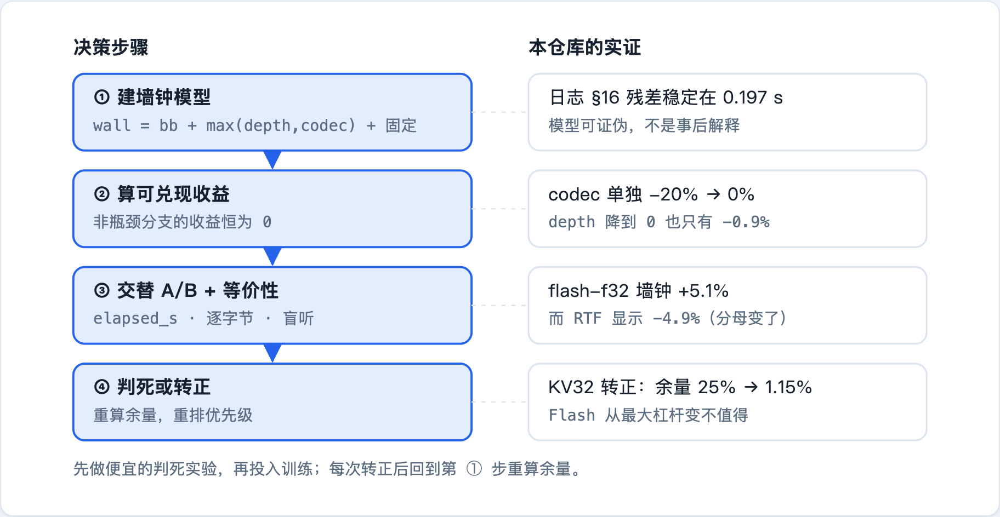
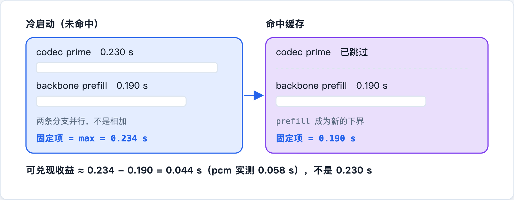

# M5-TTS 端侧推理实战（06）｜怎样决定一条优化路线是否值得继续

开源仓库：[wangyifan2018/llama.cpp](https://github.com/wangyifan2018/llama.cpp) · [M5-TTS 代码与运行说明](https://github.com/wangyifan2018/llama.cpp/tree/master/examples/m5-tts)

用真实反例建立判断顺序，从成本上界到同轮对照、等价性和收益。

## 第 10 章 · 性能分析方法：从分项计时到决策

前面十章讲的是「这个模型怎么加速」。这一章把过程中反复用到的判断方式抽出来：它们不依赖 M5-TTS，换一个推理引擎、换一块 NPU 也成立。核心只有一句——**先算清楚这个优化能兑现多少，再决定要不要动手**。

**本章目标**

- 能把「试过，没收益」升级成「有机制解释的判死」，并写清复活条件
- 掌握十条速查判据与四个反复出现的陷阱
- 会用「斜率 / 截距 + 隔离开关」把固定成本拆开（0.398 s 首包案例）

*图 10-1　四道决策门。每个「不做了」的结论都必须能追到某一道门，而不是凭感觉。*

### 10.1 为什么先建模型

分项统计（`backbone_s / depth_s / codec_s`）本身不是模型，把它们的**结构关系**写出来才是。本项目的两条分支并行重叠，所以墙钟是 `backbone + max(depth, codec) + 固定开销`，不是三者相加。用残差检验：不同配置下减出来的固定项都约 0.197 s，说明模型抓住了结构。有了它，动刀之前就能算出「codec 降 20% 值多少」——在日志 §13 的答案是 0，在日志 §16 的答案仍是 0。省下的是一整轮无用的量化实验。

### 10.2 十条速查判据

1.  先写可证伪的墙钟模型，用它算**可兑现收益**，不要用单项耗时当目标。
2.  区分「组件变快」与「端到端变快」；`max()` 结构下优化非瓶颈分支收益为 0。
3.  每次成功优化后重算余量、重排优先级：KV32 把 25% 余量吃到 1.15%，旧结论立即失效。
4.  同轮正逆序交替 A/B，固定文本与 seed、取中位数；判据是 `elapsed_s`。热漂移能让同代码 RTF 从 0.75 变 0.91。
5.  RTF 只在输出不变时可用。分母 `audio_s` 会随生成轨迹变化，必须同时看墙钟、每帧成本、输出长度。
6.  等价性分层：① codes/WAV 逐字节；② ASR + 音频统计；③ 多文本人耳盲听。heads int8 与 B/Q4 都证明「指标全对 ≠ 听感通过」。
7.  归因实验一次只改一个变量（KV 精度 × kernel 实现），并用 profile 数算子证明改动真的生效，别靠 env 名猜。
8.  算子形状比墙钟推测更接近机制：`SOFT_MAX 256:32:8:1` 直接解释融合 kernel 为何只剩 7%。
9.  负结果写清机制与复活条件：α 上界 0.18、反压是固定税、可预测性沿链衰减、kernel 改变轨迹。
10. 先做便宜的判死实验，再投入训练或改图。960 帧离线数据判死草稿，16 次合成判死 Flash 线。

### 10.3 四个反复出现的陷阱

**分母会变**

`flash-f32` 的 RTF 从 0.700 降到 0.666，看似快 5%；实际帧数 69→76、音频长 10.5%、墙钟 **+5.1%**。只看 RTF 会得到完全相反的结论。

**只看单边指标**

`--threads 3`、`chunk (2,4)`、`OPPOLL=1` 都是按「codec 单独耗时」「首包最短」定的。日志 §13 用端到端墙钟重扫 48 次，没有任何配置快于默认。

**把近似当等价**

codes 分叉、帧数漂移时，两条轨迹已经不是同一个任务；此时比速度没有意义，先过门禁再谈性能。

**沿用旧基线**

「Flash 是最大杠杆（-17%）」在 KV32 之前成立；转正后它只剩 ~0.9%。每条结论都要带上它的基线。

**冷 / 热口径混用**

CLI 每次都是新进程，codec prime 缓存必然空；常驻 server 同音色第二次起就命中，首包差约 0.08 s。之前所有分项实验用 CLI，报的都是冷启动数。延迟必须标明是「重启后首次」还是「稳态」。

### 10.4 把负结果变成资产

日志 §12–§14、§17 四条线全部判死，但留下的是可复用的机制：α 上界、固定税、可预测性衰减、kernel 轨迹漂移。写清楚「为什么不行」和「什么条件下复活」，比记录「试过没收益」有价值得多——它让下一个人不必重跑一遍，也让自己不会在换基线后重复投入。

### 10.5 案例：把 0.398 s 首包拆开

稳态 RTF 被 `max()` 锁死（日志 §16），但**首包由固定项主导，是另一本账**。扫 `--first 1/2/3/4/6/8` 两轮交替，拟合出 `first_pcm = 0.234 s + 74.6 ms/帧`（残差 \<21 ms）；斜率恰好等于 depth 单帧 31.7 ms 加 codec 单帧 40 ms。再用 `--no-overlap` 把并行项暴露：codec prime 0.230 s、backbone prefill 0.190 s，overlap 下取 `max`，所以固定项其实是 **codec prime，不是 prefill**。斜率/截距加隔离开关，比逐个埋点更省事。

`Codec::restore_prime` 按参考 codes 的最后 8 帧缓存 codec 递归状态，命中就跳过那 0.23 s。查出的问题是缓存条件错配：warmup 用的是 voice 0（官方样例），而 Web 默认 Serena，于是**每个用户的第一次请求都在给用不到的音色付冷启动**。部署层加一个 `--voice serena` 让默认音色对齐，首次 pcm 从 0.346 降到 0.280 s（wav 0.507→0.420），零引擎改动、稳态不退化。**先查缓存命中条件，往往比写更快的 kernel 更划算。**

那次优化留了个尾巴：prime 缓存是**单条目**，换音色立即失效（切回仍要 0.49 s）。下一节把这条最后的冷启动路径关掉，并顺带说明一个极易算错的账：被跳过的操作值 0.23 s，实际能省下的只有约 0.04 s。命中路径仍要发送 32 行共享 prefix——实测只值 2–4 ms（见第 11.4 节），协议改动已判死；`--first 2 --chunk 4` 已是最优，别再试更小的首块。

**Q5　某候选把 RTF 从 0.700 降到 0.666，能上线吗？**

不能只看这个数。本例中帧数 69→76，音频 5.32→5.88 s，墙钟 3.724→3.914 s（**+5.1%**），RTF 下降纯粹因为分母变长。而且四条文本/seed 的 codes 与 WAV **全部不一致**，已经不是同一个任务。正确顺序：先看过没过等价性门禁（逐字节 → ASR → 盲听），再看 `elapsed_s` 与每帧成本，最后才算 RTF。这个候选是日志 §17 的 `flash-f32`，结论是判死。

**Q6　把首块从 2 帧减到 1 帧，首包为什么反而从 0.398 s 涨到 0.616 s？**

因为 `kTail = 2400` 个样本大于单帧 `kHop = 1920`：第一个 chunk 的输出被全部留作 overlap tail，`drop = 0`，根本没有 PCM 写出。首包只能等第二个 chunk（4 帧），等于等 5 帧——`0.234 + 5 × 0.0746 = 0.607 s`，与实测 0.616 s 吻合。**减小批次不一定降低延迟，要先看输出阈值。**另外把 prime 的输出接进 tail 虽然能让 1 帧发出声音，但会把参考音色原声混进开头，不能这么修。

### 10.6 案例：把单条目缓存换成 LRU，以及「跳过 ≠ 省下」

日志 §19 留下的冷启动尾巴，改法只有约 25 行：把 `prime_codes_ / prime_inputs_ / prime_offset_` 换成 `vector<PrimeEntry>`，命中移到 front、新条目插 front、超出容量裁尾。关键是 **key 取「真正决定状态的最小输入」**——这里就是参考 codes 的最后 8 帧，而不是音色名字或索引。于是换文本不失效、同名不同内容不误命中，浏览器内联的临时音色（请求里带 `codes`）也自动纳入同一缓存。容量 4、每条目 1.04 MB，约 4.4 MB 上限；`M5_PRIME_CACHE=1` 复现旧行为、`=0` 禁用缓存，`M5_PRIME_STATS=1` 打印 hit/miss/save。

*图 10-2　稳态里 `max(depth, codec)` 吃掉单侧优化，首包里 `max(prime, prefill)` 吃掉大部分缓存收益。跳过一个操作之前，先重画一遍并行结构。*

**怎么验收**：容量按 `0,1,4,4,1,0` 交替重启 server，每轮固定序列「serena → 官方样例 → serena → 官方样例 → serena → pcm」，共 36 次请求。服务端日志给出的 prime 调用统计是 `0/13`、`8/13`、`11/13` 次命中：容量 4 多出的 3 次正好是三个「切回音色」请求。切回三请求首包中位数 **0.500 → 0.463 s（-7.5%）**；用永远冷的 cap=0 轮做热漂移基线（s1→s3 `+0.032 s`）校正后，单条目的冷启动惩罚 `+0.044 s` 被压到 `+0.005 s`。更硬的门禁是 **30 份 WAV 跨容量、跨冷热、跨 6 次重启全部同一哈希**；用 6 个不同的内联临时音色逼出 LRU 驱逐，被驱逐后重算的两个音色哈希也与首次完全相同。

**Key 取最小决定输入**

prime 状态是 8 帧 codes 的纯函数，就别用音色名字当 key。缓存语义由**被缓存的计算**决定，不由请求身份决定。

**先让缓存可观测**

hit/miss/save 日志比「首包看起来快了」可靠得多；它还能给出每条目字节数，让容量选择有依据。

**禁用缓存一物两用**

`cap=0` 既是「命中省多少」的冷基线，又是同轮热漂移的校正量——不必另跑一轮漂移实验。

**等价性跨命中状态**

不只验证「同配置两次一样」，要覆盖冷、热、驱逐后重算、不同容量、不同进程；否则缓存可能悄悄改变输出。

**Q7　缓存命中跳过了一个 0.23 s 的操作，首包为什么只快了约 0.04 s？**

因为 prime 与 backbone prefill **并行**：冷启动固定项是 `max(0.230, 0.190) = 0.234 s`，命中后 prime 消失，固定项退化成 prefill 的 `0.190 s`，省下的只是两者**差值**约 0.044 s（pcm 路径实测 0.058 s）。稳态章节里 `max(depth, codec)` 让「codec 单独 -33%」收益为零，是同一个结构在首包维度的翻版。**算收益要重画并行结构，不能拿组件耗时直接相减**；同理，也不要因为收益比预估小就判定优化无效——它仍然消除了换音色时用户能感知的那一次卡顿。 从实验开关到编译期默认 一个优化从"实验室里快"走到"生产里快"，中间还有三步：**①转成编译期默认**（KV pad 32 写进 `get_n_kv()`，`M5_KV_PAD=256` 可回退；backbone 分支显式保留 256，严格复现实验条件）、 **②部署脚本去掉特殊目录与 env 注入**（顺带补上缺失的 stage 库推送）、 **③交替 A/B 复验**（默认 3.775 s vs pad 256 4.163 s，12 次 codes 与 WAV 哈希全部相同）。 没有第 ③ 步的转正都是赌博：改的是默认值，赌的是每一个还没跑过的输入。

**Q8　既然 codec 有 25% 的空闲余量，为什么"让 codec 少干点活、把 CPU 让给 depth"没用？**

因为 **depth 的成本主体花在 HTP0 的 15 次提交**（F≈1.25 ms/次 + R≈0.91 ms/行），不是 CPU 争抢。实测把 ORT 线程从 3 降到 2 会让 codec 慢 25%，而 `depth_s` 反而略升；chunk 从 4 加到 16 让 codec 快 7%，`depth_s` 几乎不动。 并发反压确实存在（关 overlap 后 depth 快 11.3%），但它是"codec 线程存在"的固定税，不是负载强度的函数；而 overlap 本身净赚 43.9%，这笔税必须付。

下一篇：第 7 篇《重新计算性能余量：KV32、关键路径与联合优化》。
