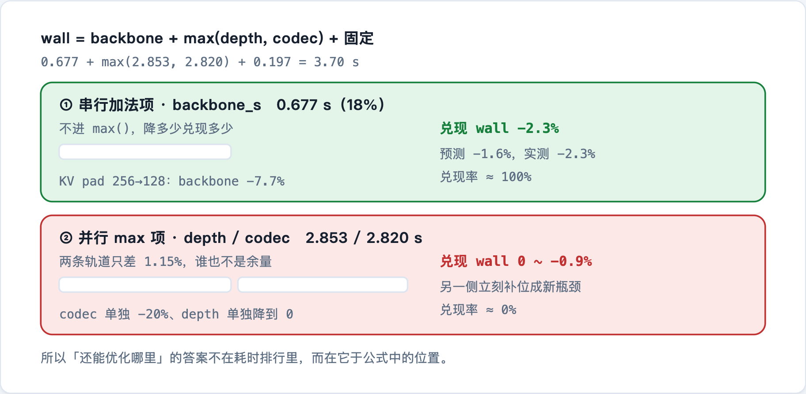
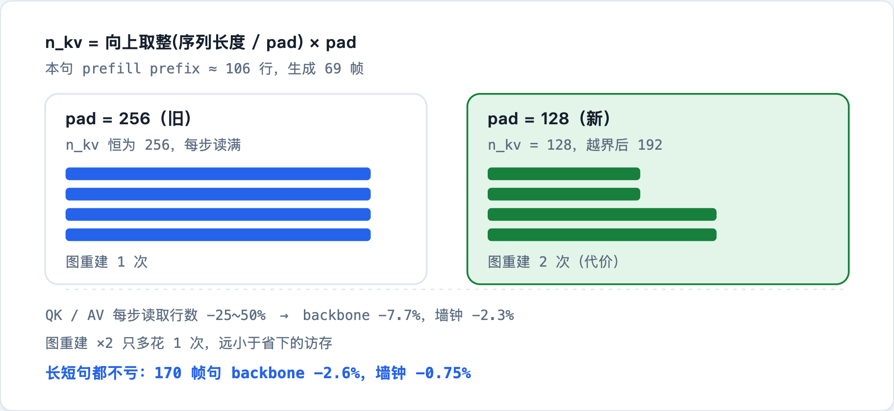
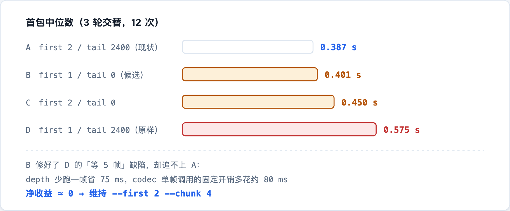
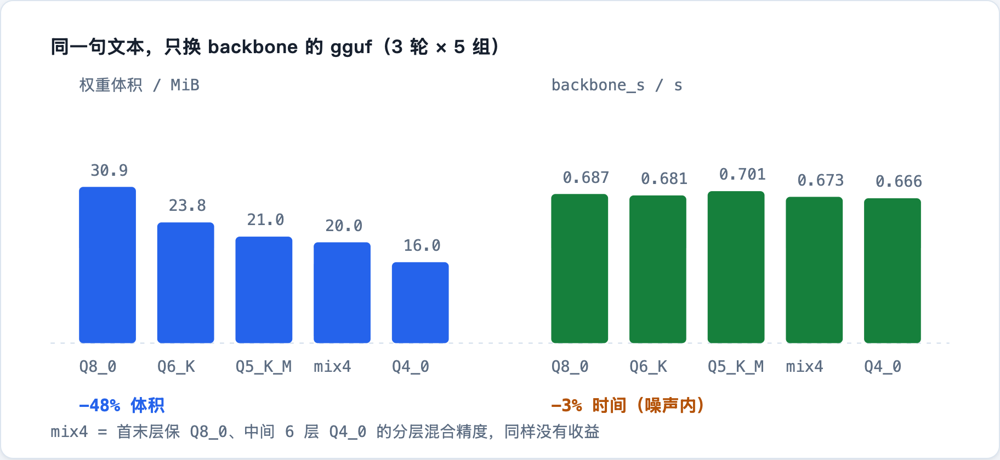
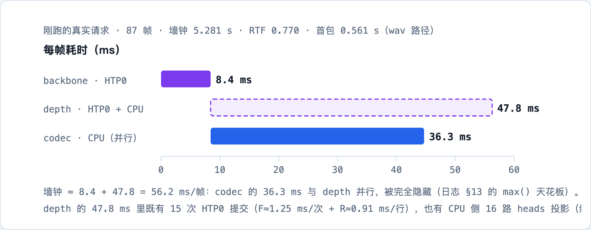
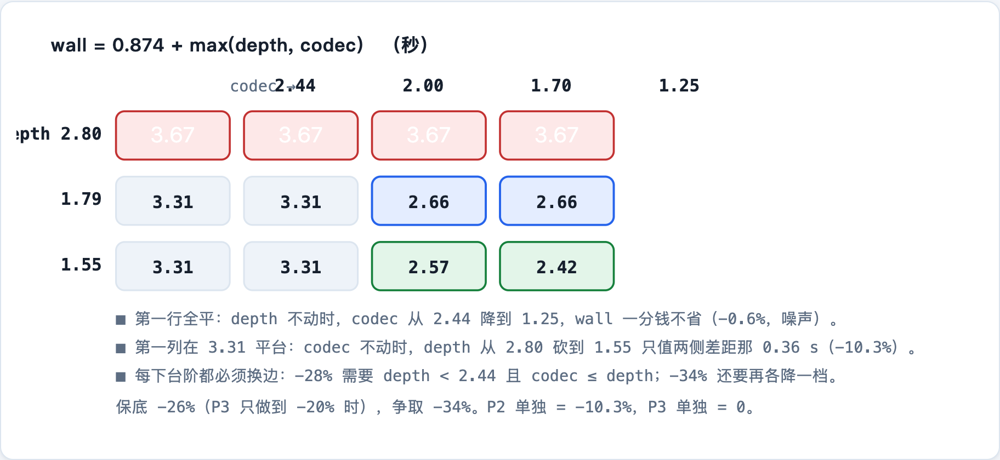

# M5-TTS 端侧推理实战（07）｜重新计算性能余量：KV32、关键路径与联合优化

开源仓库：[wangyifan2018/llama.cpp](https://github.com/wangyifan2018/llama.cpp) · [M5-TTS 代码与运行说明](https://github.com/wangyifan2018/llama.cpp/tree/master/examples/m5-tts)

把已验证的图优化和仍待验证的模型改造放进同一张成本账。

## 第 11 章 · 余量重估：串行项与 max() 的另一面

第 10 章教会你「非瓶颈分支的收益恒为 0」。但这句话有个前提：**你要先知道哪个分支在瓶颈上**。基线一旦改变（这里是把 depth 的 KV 读取范围从 256 缩到 32、又把 prime 缓存换成 LRU），瓶颈就换人了，昨天的结论今天就过期。这一章讲的是**转正之后必须做的第二件事**：重算收益矩阵，并用最便宜的手段验证它。

**本章目标**

- 能分清三个「推理时间」口径，知道做决策该用哪一个
- 能把分项耗时映射回成本模型，判断一项改动落在加法项还是 max 分支
- 理解为什么单边优化归零、为什么在当前估算中优先优化 depth，再处理 codec

本章三个实验都在「不改模型图、不重训」的前提下完成，结果是一正两负。价值不在那个正的 2.3%，而在两次负结果各自留下的可复用判据。

*图 11-1　同一句「快 20%」，写在加法项上和写在 max 分支上，价值差一个数量级。重估余量的第一步就是把分项耗时逐个映射回公式。*

### 11.1 先分清三个「推理时间」

问「还有没有优化空间」之前，必须先定口径。这三条账的分子分母都不同，混着谈会得出互相矛盾的结论：

| 口径 | 当前值 | 主导项 | 约束 |
|----|----|----|----|
| 稳态墙钟 / RTF（69 帧长句） | 3.70 s / **0.694** | `max(depth, codec)` | 并行天花板，单侧优化归零 |
| 首包（pcm，命中） | **0.28 s** | 固定 0.190 + 2 帧 × 74.6 ms | 不受 `max()` 约束 |
| 短句 RTF（≤7 字） | 常 \>0.9 | 固定项摊不薄 | 与长句不是同一张账 |

稳态那条账的残酷之处在于**两条轨道几乎完美平衡**（2.853 vs 2.820，差 1.15%）。这是最坏的优化局面：你花力气把 depth 降 20%，codec 立刻变成新瓶颈，墙钟几乎不动。反过来，只要有一项**不在 `max()` 里**，它就值得优先动手。

### 11.2 串行项：唯一能 100% 兑现的那 0.677 s

`backbone_s` 在公式里是**加法项**，占墙钟约 18%。它不在瓶颈上，所以「降 10% 得 10%」在这里成立——这是全流程唯一还有这种性质的计算项。剩下的候选手段只有两类：

1.  **KV 读取宽度（pad）**：零重编译、开关现成，门禁是逐字节等价，成本最低。
2.  **中间档量化 / 分层混合精度**：Q6_K、Q5_K 或前后层保 Q8，在 Q8 与 Q4 之间找音质拐点；一次把 Q4 试过头导致音频短 16%、韵律漂移被否掉，所以必须盲听。

先做第 1 项。历史上 backbone 的 pad 被**硬编码成 256**，原因很朴素——当初做 depth KV32 实验时要求「其他条件严格不变」。于是这个开关从没被单独测过。命令行的 `--backbone` 参数会整体替换 stage 启动命令，加个 `M5_KV_PAD=128` 前缀就能**只**注入 backbone 子进程（depth 仍是 32），一行代码都不用改。

*图 11-2　pad 不是「预分配多少内存」，而是**attention 每步实际读多少行 K/V**。代价是序列越界时重建计算图的次数，短句几乎无感，长句也能净赚。*

实测（同轮正逆序交替，取中位数）：

| 配置                  | 69 帧句 wall / backbone_s | 170 帧句 wall / backbone_s |
|-----------------------|---------------------------|----------------------------|
| pad 256（旧默认）     | 3.781 / 0.736             | 8.375 / 1.374              |
| pad 64                | 3.726 / 0.671             | —                          |
| **pad 128（新默认）** | **3.695 / 0.677**         | **8.313 / 1.338**          |
| pad 32                | 3.695 / 0.660             | —                          |

22 次运行 WAV 与 codes **全部逐字节一致**。64/32 与 128 的差异落在噪声内，但 128 的图重建次数只有它们的一半，长句更稳，所以取 128 而不是更激进的 32——**在等价收益里挑最保守的那个**。转正后 `M5_KV_PAD=256` 一键回退；顺带把 server 命中首包从 0.426–0.433 s 拉到 0.410–0.414 s。

这一项最值得记的不是数字，而是**预测对了**：事前算「backbone 占 18%、降 8% → 墙钟约 −1.6%」，实测 −2.3%（含 depth/codec 的正常波动），同量级。而同幅度的 depth 侧优化只能兑现 0.9%。**成本模型的价值就在动手前知道能拿到多少，而不是事后找解释。**

### 11.3 「修好缺陷」不等于「拿到收益」

回到首包那条加法账。`--first 1` 一直有个众所周知的毛病：单帧 chunk 只有 1920 个样本，而 `write_chunk` 要把最后 `kTail=2400` 个样本留作下一块的 overlap 缓冲——**全被扣住，一帧根本发不出声音**，首包只能等第二个 chunk（共 5 帧，0.575 s）。

修法很直接：加一个 `M5_FIRST_TAIL`，让首个 emit chunk 少扣或不扣 tail。缺陷确实修好了，但收益是负的：

*图 11-3　四组首块配置。柱子越长越慢——把「少等 4 帧」修成「1 帧出声」，结果仍比现状慢，因为省下的是 depth 的一帧，多花的是 codec 的一次调用。*

四个可迁移的点：

**看斜率项归属哪一侧**

首包 74.6 ms/帧 ≈ depth 31.7 + codec 40，是**相加**。改 `--first` 只动 depth 那一半，codec 的单帧调用固定开销却涨了——一侧省、另一侧还。

**等价性可以比 SHA 更细**

B 与 A 的 127,680 个样本只差 **1 个样本、1 LSB、位于末尾**（浮点求和顺序噪声），不是 chunk 边界伪影。**codec 输出对 chunk 切分不敏感**，此前担心的边界效应不存在。

**纯调度实验是免费的对照**

C 组（first 2 + 不扣 tail）逐字节一致，证明「边界移动本身零成本」；它把 B 的差异锁定在「少等一帧」这唯一变量上。

**负结果要留复活条件**

开关保留、默认关闭。**复活条件**：codec 单帧调用的固定开销显著下降（例如 codec 捆绑改造落地）后重测 `--first 1 + M5_FIRST_TAIL=0`。

### 11.4 先测占比，再谈改协议

prime 命中时可以跳过 codec prime，但引擎**仍然**把 32 行共享 prefix 发给 backbone stage——因为协议是「先发 header 再发两块矩阵」，少发一块需要改协议。省 64 KB 听起来值得改，先量一下：

    sh=32 rs=71–85  hdr=0.1ms  shared=1.3–3.4ms  rest=7–12ms  wait=85–101ms  total≈105ms
    m5-stage prefix hit sh=32 discard_ms=2.2–4.3

32 行（64 KB）的**传输加丢弃只要 2–4 ms**：占 prefill 往返（约 105 ms）的 3%，占命中首包（0.41 s）的 **不到 1%**。大头是 `wait` 段，也就是 backbone 对 rest 行做的真实 decode——那是算力，不是搬运。

算一下风险收益：省 2–4 ms，换一次管道错位崩溃的可能（这条协议以前踩过，错配时 stage 会读垃圾 header）。**不成比例，直接判死。**更重要的是它留下一条判据：**凡是「优化传输」的提案，先问它在端到端里占几个百分点**；单看「省了一半数据量」没有意义。

### 11.5 量化：把模型砍掉一半，为什么时间没动

backbone 剩下的候选只有「降精度」了。直觉上：Q8 31 MB → Q4 16 MB，每帧少读一半权重，该快。实测不是——五组权重精度、三轮交替，backbone 一动不动：

*图 11-4　权重体积腰斩，耗时几乎不动。当「更小的模型」不换时间时，瓶颈不是字节搬运，而是**调用次数**。*

为什么不吃带宽？把 `backbone_s` 拆开看：`0.687 s ≈ prefill 0.19 s + 69 帧 × 7.2 ms`。每帧只送 1 行（hidden 512）进去，8 层权重 Q8 约 13 MB，摊到 7.2 ms 上只有约 **1.9 GB/s**——远低于这块 LPDDR5X 的可用带宽。反过来算：每层约 0.86 ms、每层约 9 个算子，即 **每算子 0.1 ms**，正好是 NPU 的 dispatch / 同步固定成本。**69 次「1 行 decode」= 69 次独立调用，成本由调用次数决定，不由权重字节数决定。**

这次实验还附赠两个必须记住的坑。第一，**所有量化都改变了输出**：帧数 69 → 71/73/74，音频 5.32 → 5.48/5.64/5.72 s（长 3~7.5%）。分层混合（首末层保 Q8）也没救回来，帧数反而最多。第二，因此 **RTF 全部「变好」**（0.702 → 0.685），而墙钟全部变慢（+2.2~5.5%）——分母又被做大了，这是同一个陷阱的第三次出现。

判死 backbone 中间档量化（Q6_K / Q5_K_M）与分层混合精度在端到端上一律负收益，且都以韵律漂移为代价。**复活条件**只有一个：先让 69 次单行 decode 不再是 69 次独立调用（改图合并、或降低每层 dispatch 成本），单次调用变大后带宽才会重新成为限制——**先改调用形状，再谈精度**。

### 11.6 本轮新基线

| 项                     | pad 256（旧）   | pad 128（新）       |
|------------------------|-----------------|---------------------|
| CLI 69 帧 wall / RTF   | 3.775 s / 0.710 | **3.695 s / 0.694** |
| `backbone_s`           | 0.726           | 0.677               |
| server 命中首包（wav） | 0.426–0.433     | 0.410–0.414         |

`wall ≈ 0.677 + max(depth, codec) + 0.197`。`max` 两侧没动，所以「稳态下一个杠杆是捆绑（−15%，需重训）」的结论不变；剩余项只剩 backbone 分层混合精度（预期 −2~4%，必须过盲听）和热漂移/温控（要的是稳定性，不是 RTF）。

还有一件比压模型更值钱的事：**同一份代码连续跑，RTF 会从 0.75 漂到 0.91（+21%）**，比本章所有剩余优化加起来都大。如果目标是「稳定 \<1」而不是「再快 1%」，真问题在温控与长时降频，不在模型推理。

### 11.7 方法论补充

1.  **转正后立刻重算矩阵**：KV32 转正让 depth 不再是瓶颈，「间接加速 depth」的历史收益（Q4 曾 −18%）换基线后只剩 −4.6%。旧数字必须带上它的基线。
2.  **在等价收益里挑最保守的配置**：pad 32/64/128 差异在噪声内时选 128，因为它图重建次数减半，长句更稳。
3.  **append 模式的 dump 是 A/B 地雷**：`--dump-codes` 用追加写，冒烟轮与正式轮共用同名 tag 会静默叠加，产出假性 SHA 不一致（WAV 是截断写，不受影响，且 `sha256sum` 输出里 wav 在前）。**A/B 脚本每轮先 `rm -rf` 结果目录，冒烟用独立 tag。**
4.  **测量类实验别改会崩的代码**：分段计时加一次对照就能定案，不必为 2–4 ms 去动协议。
5.  **「模型变小」≠「变快」**：先判断受限类型。判别实验只要两档极端值（Q8 对 Q4，体积差 2×）；2× 体积差换不来时间，就说明不是带宽问题，别逐档试精度。
6.  **分层的价值前提是「有收益可分」**：mix4 这种边缘层保精度的做法，只在量化本身能加速时才有意义；加速为 0 时它只是「更慢 + 输出不一样」。
7.  **先做零成本的那一个**：本章第一项零重编译、门禁现成，跑 16 次就拿到 −2.3%；另外两项各花了半天证明不该做——**判死也是产出**。

**Q9　backbone 只占墙钟 18%，为什么优化它比优化占 77% 的 depth+codec 更划算？**

因为它们在墙钟公式里的**位置**不同。depth 与 codec 并行，墙钟取 `max(2.853, 2.820)`，两者只差 1.15%——把其中一侧降 20%，另一侧立刻成为新瓶颈，端到端收益约 0。backbone 是加法项：`wall = backbone + max(...) + 固定`，它降 7.7%，墙钟就真降约 7.7% 的那一份（实测 −2.3% 墙钟，符合 18% × 7.7% 量级）。**判断优化价值不是看谁耗时最长，而是看它在公式里能不能兑现。**这也解释了为什么「先降 depth」在 KV32 之前是对的、之后就不再是。

**Q10　\`--first 1\` 从「等 5 帧」修成「1 帧就出声」，为什么首包仍不如 \`--first 2\`？**

因为首包的成本是 depth 与 codec **相加**而不是取 max（流水线还没填满）。`--first 1` 让 depth 少跑一帧（约 −31.7 ms，加上后续调度约 −75 ms），但 codec 要为一个 chunk 单独调用一次，单帧调用的固定开销让 `codec_s` 从 2.77 涨到 2.87 s，多花约 80 ms，两者抵消。实测 0.401 vs 0.387 s。要让它转正，得先把 codec 的单次调用开销降下来——所以这个开关的价值不是「现在能用」，而是**把复活条件写清楚**，等 codec 捆绑改造落地后只需重跑一次。

### 11.8 真实一帧，与"两版数字"的教训

2026-11-15 03:31 的实跑请求（Serena，87 帧）：墙钟 5.281 s、RTF 0.770、首包 0.561 s；分项 `backbone 0.734 / depth 4.160 / codec 3.156 s`，折合每帧 8.4 / 47.8 / 36.3 ms。

*图 11-5　codec 与 depth 并行，墙钟取两者的最大值——这是理解后面所有"优化为什么没收益"的关键。*

把结构变成判据 `wall ≈ backbone + max(depth, codec) + prefill`。两条分支一旦接近， **任何单边优化都会被 max() 吃掉**：codec 变快而 depth 不变，墙钟一动不动； depth 变快到 codec 以下，codec 立刻变成新瓶颈。这比"哪个模块慢就优化哪个"的直觉重要得多。 后来修正（台账 §30） 上面写的"两条轨道只差 1.15%"来自日志 §25 的**斜率外推**（41.3 vs 40.9 ms/帧）； 日志 §29 的进程族记账给出的**段实测**是 40.6 / 35.4 ms/帧——差 13%。这一版数字改写了台阶的起点： depth 减到 codec 以下时，先有约 0.36 s 的空档是白送的，因此 P2（depth 重训）单独可兑现 **−10%** 而不是 0。 **斜率拟合适合回答"再多一帧要多久"，段实测才适合回答"哪一侧在瓶颈上"。** 两版数字都留在这里，正是为了示范：结论要跟着测量口径走，而不是跟着记忆走。

### 11.9 depth 与 codec 联合重训的收益估算

免重训的手段全部穷尽后，收益矩阵只剩一条路：**让两侧一起降**。数学上很直白—— `wall = 0.874 + max(depth, codec)`，要端到端降 δ，两侧都必须 ≤ (1−δ)×现状； 单边改进要么被 max() 吃掉，要么只吃到两侧差距那一小截。这就是"捆绑"的含义： depth 重训（把 15 步压成 2 步）与 codec 收窄必须同批立项，**按当前假设，建议顺序为 P2 → P3 → P2'。**

| 台阶 | 改动 | depth | codec | wall | Δ |
|----|----|----|----|----|----|
| R0 现状 | — | 2.80 s | 2.44 s | 3.70 s | — |
| **R1** | P2 · G2：15 步压成 2 步（粗 8 + 细 8） | **1.79** | 2.44 | **3.31** | **−10.3%** |
| **R2** | \+ P3 · codec decoder 收窄 −27% | 1.79 | **1.79** | **2.66** | **−27.9%** |
| **R3** | \+ P2 · G16：一步出全部 16 book | **1.55** | 1.79 | **2.42** | **−34.4%** |

*图 11-6　联合收益矩阵。画成矩阵而不是两个单点，才能看见"两级平台"——也能看见当前估算中，每次瓶颈换边后为何要重算收益。*

两个工程细节让这条路线比看起来更可行：其一，**分组粒度只有一种含义**——一次 HTP 调用里的 N 行是并行的，所以同批的 book 必须条件独立，"G2（2 批 × 8 本）"支配"G4（4 批 × 4 本）"； 其二，它**不需要新的 HTP 算子**——现有的"1 次 16 行"形状早就实测过，部署侧几乎零改动。 公开先例也现成：VALL-E 的 NAR head、MOSS-TTS 的 33 个并行 head、Qwen3-TTS 的 MTP 都是同一个动作。

门槛不在模型，在数据 P2 需要 ≈100 h 可商用语料（2.25 M 帧训练样本 + 教师逐 book logits），P3 需要 50 h； 官方三条样例（约 20 s）不能用于训练。**没有语料这不是"做得慢"是"做不了"**—— 这一条应该在讨论任何模型细节之前先确认。 决策（2026-11-15） 单路 RTF 0.68 已满足实时、首包 0.26 s 与它无关——P2+P3 卖的是**并发**（CPU 10.6 → ≈7.2 秒/请求， 单机 2–3 路才装得下）与**功耗**，不是"更快"。触发立项的三个条件：产品要多路、功耗受限、 且已有语料。都不满足时，正确动作是把"单机 1 路 + 2 路限流"写进产品文档。 计划、门禁与 kill 判据的完整版在台账 **§30**。

下一篇：第 8 篇《迁移推理优化方法，以及把 Serena 用到 M5》。
