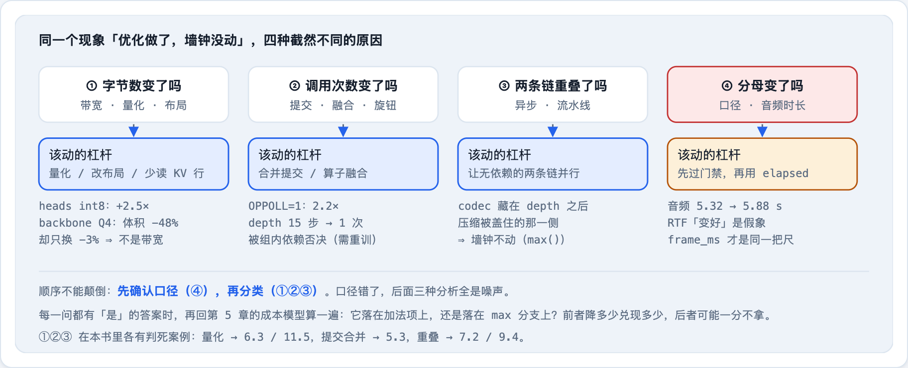
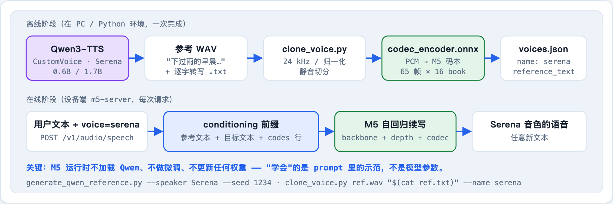
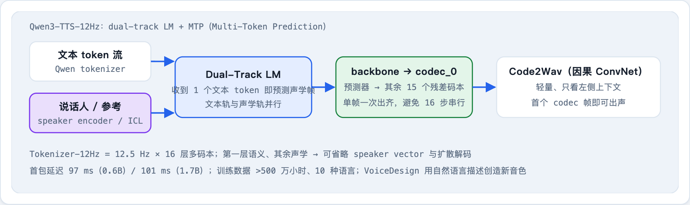

# M5-TTS 端侧推理实战（08）｜迁移推理优化方法，以及把 Serena 用到 M5

开源仓库：[wangyifan2018/llama.cpp](https://github.com/wangyifan2018/llama.cpp) · [M5-TTS 代码与运行说明](https://github.com/wangyifan2018/llama.cpp/tree/master/examples/m5-tts)

回看哪些方法可以带到别的模型，再用跨模型参考音色作为具体例子。

## 第 12 章 · 从案例到方法论：llama.cpp 推理加速通用套路

把上面 20 多次尝试压缩成一张可以带到别的项目里的检查表。

**本章目标**

- 拿到一张八杠杆检查表，能按「先问什么」排序
- 能把 llama.cpp 的旋钮映射到自己项目的对应物
- 记住五个反模式，避免在同一类坑里重复投入

### 12.1 八个杠杆，按"先问什么"排序

| \# | 杠杆 | 先问的问题 | llama.cpp / 后端对应 | M5 案例 |
|----|----|----|----|----|
| 1 | 可观测性 | 我量的是哪个口径？分项在哪？ | `llama_perf_context_print`、自定义 timers / headers | X-M5-\* + /metrics |
| 2 | prefill / decode 分离 | 固定成本与每 token 成本各多少？ | `n_batch / n_ubatch`、prompt 复用 | 线性拟合 152 ms + 48.6 ms/帧 |
| 3 | KV 复用 | 有没有跨请求/跨段共享前缀？ | `llama_memory_seq_rm`、prefix cache、`seq_id` | count == -1 协议 |
| 4 | 批处理 / 提交合并 | 依赖是否允许？F 有多大？ | `llama_batch.n_tokens`、ubatch、continuous batching | depth-bench 15→1（被依赖否决） |
| 5 | 量化 / 权重布局 | 是不是带宽瓶颈？ | GGUF `Q4_0/Q8_0`、`llama-quantize`、f16/f32 KV | heads int8 生效、backbone Q4 否决 |
| 6 | 算子融合 / 后端旋钮 | 扫描次数与提交次数能否减少？ | ggml graph fusion、backend env、flash attention | Snake 融合、OPPOLL=1 |
| 7 | 异步重叠 | 哪两条链互不依赖？ | 多 stream / async、pipeline parallel | codec worker 藏在 depth 后 |
| 8 | 冷启动 / I/O / 状态 | 首请求为什么慢？状态能留吗？ | model warmup、mmap、session 复用 | 预热、restore_prime、WavWriter 内存模式 |



*图 12-1　四问定位。这张图是第 10 章停止投入的判据的正向版本：不是「怎么否定一个想法」，而是「先问哪四个问题，才能把一个想法放到正确的杠杆上」。*

### 12.2 llama.cpp 的旋钮怎么映射到本案例

    # 通用 llama.cpp 参数 → 在 M5 里的对应物
    n_ctx / n_batch / n_ubatch   →  backbone.cpp n_ctx=2048（depth=256）, n_batch=n_ubatch=prefix
    type_k / type_v              →  GGML_TYPE_F32（depth 图小，KV 非瓶颈，不为省内存冒险）
    embeddings=true, pooling=NONE→  需要 llama_get_embeddings_ith(ctx, -1) 取 hidden
    llama_batch.embd             →  自定义 512 维输入，绕开 token id 与 lm_head
    llama_memory_seq_rm          →  前缀 KV 缓存命中时保留 [0, sh)
    GGUF Q8_0 / Q4_0            →  backbone / depth 权重；host 用 llama-quantize 转
    ggml_backend_load_all        →  选择 HTP0（shell 域）或 CPU（App 域）
    GGML_HEXAGON_*               →  DSP 提交/轮询/融合策略，按工作负载扫参

可以看到一条很实用的"借壳"路径：**把自定义模型的权重导成 GGUF、把自定义输入塞进 `llama_batch.embd`， 就能复用 llama.cpp 的 KV cache、后端调度、量化与图优化**；只有采样头和辅助模块留在外面自己写。 这比从头写一套推理引擎便宜得多，代价是必须遵守框架对 `n_embd`、batch、位置编码的约定。

### 12.3 性能问题诊断模板（可直接抄）

1.  **锁定口径**：固定输入、固定种子、设备冷却到同一状态；记录 RTF、墙钟、首包、帧数。
2.  **画泳道**：把 prefill / 主 decode / 辅助解码 / I/O 画在时间线上，标出哪些重叠、哪些串行。
3.  **拟合**：`T(N) = 截距 + 斜率 × N`；截距归冷启动，斜率归热路径。
4.  **分类瓶颈**：改字节数（带宽）、改调用次数（提交）、改并发（竞争）、改输入长度（依赖），一次只动一个变量。
5.  **算天花板**：该环节占墙钟百分之几 × 最多提速几倍。占比 \<10% 的环节先别碰。
6.  **做 A/B**：同轮交替、至少两轮；把负结果和复活条件一起写进文档。
7.  **过门禁**：数值正确性 → 生成分布 → 语义/感知 → 必要时人耳/人眼。
8.  **固化**：把赢下来的配置写进部署脚本与监控，防止下次重启静默回退。

### 12.4 五个反模式

**看构建日志判断优化生效**

宏名不匹配让 f16 成了死代码；要以产物为准。

**跨轮比较绝对值**

热漂移能让同代码 RTF 0.75→0.91。

**把 ASR 正确当音质正确**

Q4 韵律漂移，只有试听能发现。

**盲目批处理 / 盲目换后端**

依赖不允许时，批量只会毁输出；ring 比 pipe 慢。

**优化被隐藏的时间**

codec 被 depth 重叠盖住，压缩它当时不改善 RTF。

## 第 13 章 · 音色是怎么"学"来的：从 Qwen3-TTS 到 M5

这一章回答一个特别容易误解的问题：换音色到底有没有训练？

**本章目标**

- 能复述本仓库里 `serena` 音色从 Qwen3-TTS 迁移到 M5 的完整链路
- 理解离散多码本 token 为什么能承载说话人身份
- 区分零样本克隆的两条机制（speaker embedding / in-context learning）
- 知道 Qwen3-TTS 的双轨 + MTP 架构，以及 llama.cpp 里的落地方式

### 13.1 先澄清：仓库里有两条独立的 TTS 线

**① examples/m5-tts（本教程主角）**

Android/HTP 移植的 M5 引擎。运行时**只用自身的 codec codes**，conditioning 用 `<|caption_begin|>…` 系列标记。Qwen 只出现在**离线生成参考 WAV** 的脚本里。

**② tools/tts + src/models/qwen3tts（llama.cpp 原生）**

`llama-tts -hf ggml-org/Qwen3-TTS-12Hz-1.7B-Base-GGUF`，经 libmtmd 跑完整 Qwen3-TTS，用 ChatML wrap 与 `<|codec_*|>` 特殊 token。

用户问的"TTS 怎么学 Qwen3-TTS 的音色"，在这个项目里指的是第 ① 条线： **用 Qwen3-TTS 的 CustomVoice 预设音色 Serena 合成一句参考音频，再把这段音频转换成 M5 能理解的 codec codes， 作为"示范"写进 M5 的 prompt**。下面把这条链路拆开。

### 13.2 Serena 的诞生：五步，零梯度



*图 13-1　Serena 音色的迁移链路。训练只发生在 Qwen3-TTS 自己被训练时；跨模型迁移靠的是**共同可表示的离散音频 token**，是一次纯推理时的 in-context 迁移。*

### 13.3 为什么一堆整数 codes 能带音色

神经音频 codec（如 RVQ / 多码本量化）把波形压成 `[帧, 码本层]` 的整数序列。 M5 与 Qwen3-TTS-12Hz 都是 **12.5 Hz、16 层码本** 的设定；Qwen3-TTS 技术报告明确： 第一层码本偏向语义内容，后续层逐层补充声学细节（音色、气息、环境、韵律）， 因此容量足够用轻量级因果 ConvNet 直接重建波形，**不需要单独抽取说话人向量，也不需要扩散模型**。

**离散化带来的好处**

说话人身份被编码成 token 序列后，语言模型可以像处理文本一样"读"它；于是音色变成了上下文，而不是某个需要注入的向量。

**为什么必须带逐字转写**

M5 的 prompt 里参考文本与 codes 是配套的：模型需要知道这段声音"说的是哪句话"，才能把音色与内容解耦，续写新文本时沿用前者、替换后者。

**为什么 3-30 秒就够**

零样本克隆不更新权重，只需要足够覆盖音素与韵律的上下文。本项目的 serena 参考约 65 帧（≈5.2 s），服务端上限 375 帧（30 s）。

**情感也在这里**

语气、语速、停顿同样留在 codes 里。所以"换一段带情绪的参考音频"比写 caption 更可靠（见 13.7）。

### 13.4 零样本克隆的两条机制

| 机制 | 做法 | 优点 | 局限 | 本案例 |
|----|----|----|----|----|
| **Speaker embedding** | 说话人编码器把参考音频压成固定维向量，注入 LM 的每一步 | 实时、与文本无关、便于跨语言 | 容易丢韵律细节；需要联合训练编码器 | Qwen3-TTS 的实时克隆路径；llama.cpp 里映射为 mtmd audio encoder |
| **Text–speech pair / in-context** | 把「参考文本 + 参考音频 codes」直接拼进 prompt，让模型续写 | **更好地保留韵律**；无需额外编码器 | 占上下文长度；依赖 tokenizer 与训练格式 | **M5 走这条**：voices.json 里的 codes 作为前缀行 |

一句话回答"怎么学的" 没有梯度下降、没有 LoRA、没有微调。Qwen3-TTS 生成的一段音频被**重新编码成 M5 自己词表里的离散 token**， 作为 few-shot 示范放在 prompt 前面；M5 在自回归续写时把这段示范的统计特征（音色、语速、韵律）延续下去。 这在机器学习里叫 **in-context learning（上下文学习）**，是推理时行为，不是训练时行为。

### 13.5 Qwen3-TTS 本身：为什么能 97 ms 出第一个音包



*图 13-2　Qwen3-TTS 12 Hz 路径用首码本与主模型的隐状态来生成其余 15 个码本。官方预测器调用 `generate()` 逐步生成剩余 token。[官方实现](https://github.com/QwenLM/Qwen3-TTS/blob/main/qwen_tts/core/models/modeling_qwen3_tts.py)*

### 13.6 llama.cpp 怎么把 Qwen3-TTS 塞进现有框架

仓库的 `conversion/qwen3tts.py` 与 `tools/mtmd/mtmd-helper-gen.cpp` 展示了一组很聪明的映射：

| Qwen3-TTS 组件 | 映射到 llama.cpp | 关键技巧 |
|----|----|----|
| codec token | 扩展词表，追加 `<|codec_0|>…<|codec_1023|>`、`<|codec_bos|>`(2149)、`<|codec_eos_token|>`(2150)、`<|codec_language_chinese|>`(2055) | 把音频码字当成"词"，复用 embedding 表 |
| text projection MLP | 折进 embedding 表 | 减少一层计算，保持标准 decode 路径 |
| codec_head | 输出张量比词表小，推理时 pad logits | 兼容 llama.cpp 的 logits 布局 |
| speaker reference encoder | mtmd audio encoder | 复用多模态音频编码通路 |
| backbone | 标准 libllama 自回归文本模型 | 采样时 `suppress_tokens` 限制只出语义码本或 EOS |
| code_predictor / code2wav | `MTMD_GEN_PROCESS_TYPE_GEN_CODE` / `GEN_WAV` | 把"预测其余 15 码本"和"解码波形"作为生成流水线的两个阶段 |
| 输入格式 | ChatML wrap + `sum_row()` 把文本 embedding 与 codec/speaker embedding 相加 | `<|im_start|>assistant\n…<|im_end|>\n<|im_start|>assistant\n` 后切片 |

把这张表和 3.2 的归属全景并排看，就是本教程最想让你体会的一点： **llama.cpp 不关心你的 token 是字还是声音，它只关心 embedding 行、位置、序列 id 与计算图**。 M5 与 Qwen3-TTS 两条实现，一个用 `llama_batch.embd` 直接注入，一个把音频码字扩进词表—— 两条不同的"借壳"路线，共享同一套 KV / 后端 / 量化基础设施。

### 13.7 情感控制为什么难：一个弱训练槽的案例

M5 的 conditioning 里有 `<|caption_begin|>…<|caption_end|>` 风格槽，但官方推理把它硬编码为空。 项目做过 7 档 caption（NONE / happy / sad / angry / gentle / 开心 / 悲伤）× 同句同种子，再用 4 个种子做噪声基线：

| 路径 | 实测证据 | 难度 |
|----|----|----|
| caption 风格槽 | 非空 caption 让时长 +0~42%，但 F0 / 能量变化落在种子噪声 ±8% 内 → 弱训练槽，无可靠语义情感控制 | 接线低，效果不可靠 |
| 情感参考音频克隆 | codes 强烈迁移音色与韵律；录一段带目标情绪的参考即可 | **低**，但情感与音色绑定 |
| DSP 后处理 | 变调 / 变速 / EQ 可预测但机械 | 低 |
| 训练侧（情感标注 CPT / SFT） | 模型卡注明改动 delimiter 需要继续预训练；稀疏训练导致 caption 无效 | **高** |

实验纪律 种子带来的 F0 采样噪声本身就有 ±8%，所以任何 \<10% 的"情感差异"都不可信—— **验证情感/风格效果必须多种子平均**。这与 4.1 讲的热漂移是同一类问题：先量噪声底，再谈信号。 相比之下 Qwen3-TTS 的 VoiceDesign 变体是专门用自然语言描述 + instruction 训练过的，属于"训练侧把槽位填满"。

### 13.8 想自己做一个音色？五步 recipe

``` bash
# 1) 用 Qwen3-TTS 生成参考音频与逐字稿（离线，PC / Python 3.12）
python generate_qwen_reference.py serena.wav --speaker Serena
#    可换 --model Qwen/Qwen3-TTS-12Hz-1.7B-CustomVoice --instruct '语气轻柔温暖…'

# 2) 检查 WAV 内容与 .txt 逐字一致（不一致要手工改稿）

# 3) 用与部署模型配套的 encoder 转成 codes（16 book × T 帧，值域 0..2047）
python clone_voice.py serena.wav "$(cat serena.txt)" --name serena --voices model/voices.json

# 4) 部署到设备，服务端只在 /v1/voices 里看到 name + reference_text + codes
./deploy.sh

# 5) 用一句与参考不同的文本试听，验证音色迁移而非内容复述
curl -s -X POST localhost:18080/v1/audio/speech \
  -H 'Content-Type: application/json' \
  -d '{"input":"明天下午的会议需要准备哪些材料呢？","voice":"serena","response_format":"wav"}' -o out.wav
```

Web 控制台里也可以直接录音克隆：`/v1/voices/encode` 跑 `codec_encoder.onnx` 返回 codes，但**只保存在浏览器 localStorage**，服务端不落盘——这正是"零样本克隆不需要训练"的另一个体现： 换一段参考音频，只是换一段 prompt。

下一篇：第 9 篇《实验手册：复现命令、思考题和术语》。
